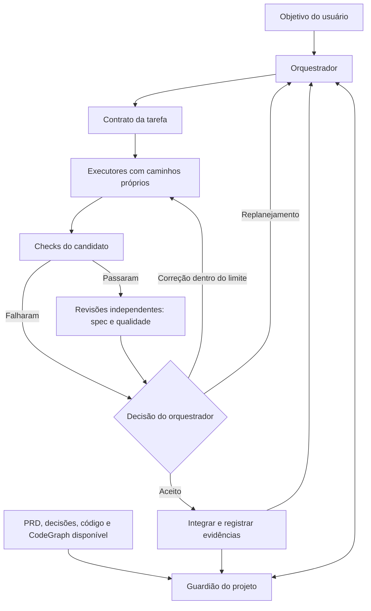
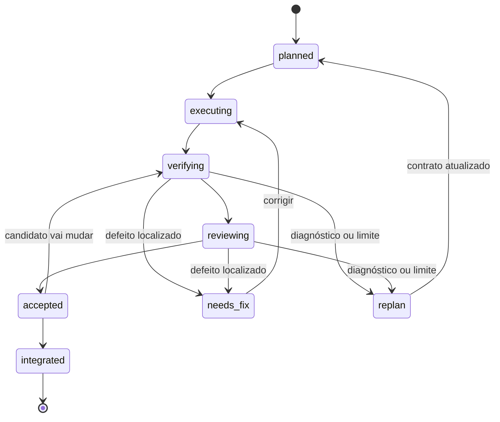

# Loop de desenvolvimento com agentes

Este fluxo é implementado pela skill local [project-loop](../.agents/skills/project-loop/SKILL.md) e por um pequeno controle de estado em Node.js, sem dependências externas. O host executa a coordenação e a delegação; o script valida contratos e registra transições. Não há daemon, scheduler ou chamadas de IA no script.

Os limites e responsabilidades de [AGENT_WORKFLOW.md](AGENT_WORKFLOW.md) continuam valendo. A presente skill acrescenta contratos operacionais, roteamento de skills e registros de estado. Regras do usuário e restrições da sessão prevalecem.

## Papéis

| Papel | Responsabilidade | Permissão padrão |
| --- | --- | --- |
| Guardião | Preparar contexto com fontes, revisão, invariantes, dependências e dúvidas. | Leitura; propõe atualizações ao orquestrador. |
| Orquestrador | Definir tarefas, dependências, propriedade dos arquivos, limites e decisão de integração. | Contratos, registros e integração autorizada. |
| Executor | Implementar uma fatia observável do produto. | Escrita nos caminhos atribuídos. |
| Revisor de especificação | Conferir cada aceite contra o candidato. | Leitura e verificações permitidas. |
| Revisor de qualidade | Conferir padrões, correção e limites entre módulos. | Leitura e verificações permitidas. |

Papéis não exigem cinco agentes permanentes. O guardião é consultado quando o contexto muda; executores são acionados para tarefas prontas; revisores recebem contextos independentes. Começar com até três subagentes simultâneos, respeitando a capacidade do host. Ambos os eixos de revisão permanecem separados mesmo quando executados em sequência.



## Usar no projeto

Iniciar uma mudança com uma instrução como:

```text
Use $project-loop para executar a fatia V01 de docs/BACKLOG.md.
Consulte o guardião, delimite os arquivos de cada executor e revise
especificação e qualidade em contextos independentes. Registre checks reais.
```

Se a skill ainda não aparecer no catálogo da sessão, indicar seu caminho `.agents/skills/project-loop/SKILL.md`. A invocação solicita trabalho local; autorização para publicar ou operar Moodle real continua sendo específica.

1. Copiar `.agents/skills/project-loop/assets/task.json` para `docs/tasks/<id>.json` e preencher o contrato.
2. Registrar o relatório do guardião em `contextEvidence`. Substituir os rótulos de agentes por identidades que permitam verificar autoria e independência nos relatórios. Satisfazer dependências antes de despachar.
3. Validar e mover a tarefa para execução:

```sh
node .agents/skills/project-loop/scripts/task-state.mjs validate docs/tasks/<id>.json
node .agents/skills/project-loop/scripts/task-state.mjs transition docs/tasks/<id>.json executing
```

4. Capturar a revisão do candidato em `revision`, mover para `verifying`, executar os checks e salvar seus resultados. Cada check usa `status`, `revision` e `evidence`. Um check de documentação pode ser uma inspeção concreta de links e contratos.
5. Mover para `reviewing`, obter os dois relatórios e preencher `reviews`. Associar evidências e revisão a cada item de `acceptance`. Somente então mover para `accepted`.
6. Integrar o candidato revisado, registrar `integration.revision` e `integration.evidence`, e mover para `integrated`. Antes de qualquer mudança de conteúdo após aceitação, voltar a `verifying`; as aprovações anteriores serão invalidadas.

Todos os caminhos dos comandos são relativos à pasta Moodle-AI. Os relatórios podem ficar em `docs/tasks/<id>/`; o orquestrador é o único escritor do registro JSON. Quando Git não estiver disponível, a revisão precisa usar um snapshot e um digest do conteúdo inspecionado. Um nome arbitrário no campo de revisão não comprova a imutabilidade do candidato.

A gravação usa substituição atômica. O sandbox Windows desta sessão negou essa substituição; o teste de persistência passou fora dele. Em um host com essa restrição, adicionar `--stdout` emite a transição validada sem gravar: aplicar o JSON resultante por uma ferramenta de edição permitida e validar o arquivo salvo. Uma falha de gravação não representa mudança de estado concluída.

## Estados e limites



O diagrama usa `needs_fix`; o valor no JSON é `needs-fix`. Estados anteriores à integração também podem ir a `replan`. O script mantém o histórico das transições e referências às evidências anteriores.

```sh
node .agents/skills/project-loop/scripts/task-state.mjs transition docs/tasks/<id>.json needs-fix "Título exportado diverge do aceite A1; ver relatório de spec."
```

O padrão permite duas correções. Um terceiro pedido de correção encaminha para `replan`. Replanejar não zera o contador automaticamente. O orquestrador também controla tempo e custo pelo host; o script não mede tokens, tempo de execução ou a veracidade dos relatórios.

O helper rejeita transições fora de ordem, checks e aprovações de outra revisão, evidência de aceite ausente, identidade do executor como revisor, contextos de revisão iguais e caminhos de escrita sobrepostos entre executores. Ele verifica o registro; o orquestrador ainda confere os arquivos, as identidades reais, os comandos e os resultados. Nesta configuração não houve execução de subagentes nem aprovação independente de uma fatia do produto.

## Skills e evolução

O [roteamento de skills](../.agents/skills/project-loop/references/skill-routing.md) referencia as skills instaladas do Matt Pocock e `frontend-design`, e descreve a adoção opcional de Impeccable sem substituir a direção do produto. A skill upstream `code-review` requer Git e configuração de tracker; o fluxo local não simula esses pré-requisitos.

CodeGraph alimenta o guardião quando conectado e atualizado. A falta do grafo não autoriza inventar dependências: a inspeção local fornece o contexto e a limitação fica registrada. PRD e decisões escritas continuam fornecendo a intenção do produto.

Evoluções úteis depois das primeiras entregas:

- Selecionar especialistas conforme o impacto real da mudança.
- Medir correções, causas de replanejamento, aprovação na primeira revisão e custo por tarefa.
- Comparar alternativas de arquitetura em experimentos curtos com critérios previamente definidos.
- Acrescentar verificação de jornadas completas no navegador e restauração em Moodle de teste conforme os aceites do backlog.

## Verificação do controle de estado

```sh
node --test .agents/skills/project-loop/scripts/task-state.test.mjs
```

Os testes usam tarefas fictícias e exercitam bloqueios, evidência desatualizada, autoria, colisão de caminhos, limites de correção e persistência. Seus relatórios simulados não são evidência de testes da aplicação Moodle.
