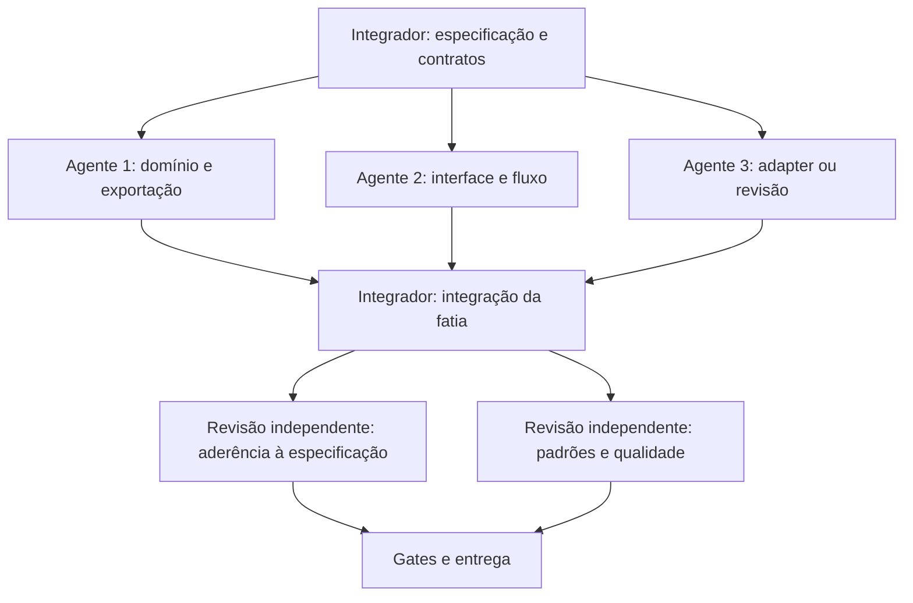

# Trabalho com subagents

O usuário conduz o projeto solo. O agente principal atua como integrador e pode coordenar até três subagents ao mesmo tempo: quatro slots no total. Subagents executam partes de uma fatia aprovada; o integrador continua responsável pela coerência e pela entrega.

## Antes de dividir trabalho

1. Ler a especificação, o backlog e as instruções locais. Consultar CodeGraph para dependências e impacto quando houver código indexado. O servidor MCP está instalado e foi testado, mas precisa ser carregado numa sessão da pasta nova como projeto confiável. A CLI local pode atender subagents: `npm exec --offline -- codegraph explore "<símbolo ou pergunta>"`. Conferir a raiz e a atualidade; sem resultados, usar buscas/imports e registrar a limitação.
2. Escolher uma fatia vertical e fixar o contrato compartilhado: entradas, saídas, erros, versão do draft e invariantes. Resolver dúvidas que bloqueiam o contrato antes de distribuir arquivos.
3. Registrar uma tarefa por agente com objetivo, arquivos permitidos, dependências, aceites, comandos de verificação e exclusões. O CourseGen-AI permanece apenas referência.
4. Propor mudanças de arquitetura num diagrama Mermaid curto e numa decisão escrita com tradeoff. O diagrama orienta a implementação; não substitui um contrato validado.

## Propriedade e integração

- Integrador controla contratos compartilhados, dependências, configuração e integração. Um arquivo possui um único responsável por vez; avisar antes de alterar algo fora da própria tarefa.
- Domínio/exportação e UI podem avançar em paralelo usando o contrato acordado. Adapter inicia com entradas/saídas estáveis. Quando o contrato muda, comunicar, ajustar os consumidores e repetir as verificações afetadas.
- Agente não instala dependências, cria infraestrutura, publica, executa operações em Moodle real ou muda escopo sem estar autorizado para isso. Leitura e testes locais pertencentes à tarefa podem seguir autonomamente.
- Cada entrega informa arquivos alterados, comportamento final, comandos executados com resultado e limitações concretas. Não tratar ausência de dependência como bug da implementação nem inventar resultados.
- O integrador confere o diff completo e roda os gates da fatia integrada. Repetir testes quando houve nova mudança, falha ou dúvida; evitar repetir verificações sem motivo.

## Revisões independentes

Antes de concluir uma fatia, obter duas avaliações separadas do implementador:

| Avaliação | Pergunta | Saída esperada |
| --- | --- | --- |
| Especificação | O comportamento satisfaz os aceites e o escopo aprovado? | Aceite por ID, divergência reproduzível ou requisito ainda sem evidência. |
| Padrões e qualidade | Os contratos, limites entre módulos, erros e testes são sólidos? | Achados com prioridade, arquivo/linha, efeito e proposta concreta. Distinguir risco por leitura de exploit demonstrado. |

Essas avaliações podem ser feitas em sequência pelo mesmo agente independente, com prompts e relatórios distintos, para caber nos slots. Um agente liberado pode revisar outro domínio; o autor não é a única aprovação do próprio código. Achados bloqueadores voltam ao responsável, e a revisão verifica a correção antes da entrega.

## Verificação por tipo de mudança

| Mudança | Gate mínimo |
| --- | --- |
| Domínio, exportação ou contrato crítico | TDD: caso de comportamento/invariante falha antes da implementação, passa depois. Fixtures sintéticas; validar XML e referências do pacote gerado quando pertinente. |
| API, IA, upload ou adapter | Testes de contrato com serviço simulado: entrada inválida, autorização, limites, timeout e falha parcial. Nenhuma chamada de teste ao Moodle real. |
| Componente ou fluxo de UI | Typecheck e verificação no navegador. Cobrir caminho feliz, erro, estado vazio e retorno/edição. Smoke E2E para as jornadas principais, além de teclado e layout estreito. |
| Integração da fatia | Typecheck, lint, testes relevantes e build. Registrar ambiente e resultado; limitação de ambiente fica explícita. |
| Deploy público | Gates S01–S04 do backlog e restauração em Moodle de teste concluídos. Demo com dados fictícios e sem consumo irrestrito de credenciais do servidor. |

TDD protege comportamento, não a estrutura interna escolhida pelo agente. Mudanças pequenas de documentação ou acabamento visual não precisam de testes artificiais. Regras críticas do legado devem ser preservadas ou substituídas por decisão explícita e teste correspondente.

## Skills e ferramentas locais

As 13 skills de Matt Pocock e `frontend-design` foram instaladas na pasta `.agents/skills` pelo `npx skills`. Fontes e hashes estão em `skills-lock.json`. O registro completo, os links locais e os comandos de verificação estão em [Skills e CodeGraph MCP](SKILLS_AND_MCP.md). Ler a `SKILL.md` correspondente antes de usar; não assumir comandos ou instruções de versões anteriores.

CodeGraph está instalado como dependência local `@colbymchenry/codegraph@1.6.2`, com configuração MCP em `.codex/config.toml`. O teste de protocolo confirmou `initialize`, `tools/list` e uma consulta por `codegraph_explore`. O índice inicial não contém símbolos da aplicação. A configuração local precisa de projeto confiável e reinício do Codex; não declarar que o MCP está conectado até aparecer na lista de ferramentas da nova sessão.

A instalação das skills não executa automaticamente `setup-matt-pocock-skills`, `to-spec`, `to-tickets` ou TDD. Os workflows de especificação e tickets devem seguir a configuração de acompanhamento e domínio escolhida quando forem invocados. Os documentos atuais são propostas locais revisadas por subagentes.

Ordem sugerida: esclarecer requisitos com documentação → especificação → tickets → proposta de arquitetura/impacto → implementação orientada pelos aceites → revisão da especificação e de qualidade. O MCP de CodeGraph apoia leitura de impacto quando disponível; Mermaid registra a proposta de arquitetura. Nenhuma ferramenta substitui a revisão do integrador nem os gates executados.
