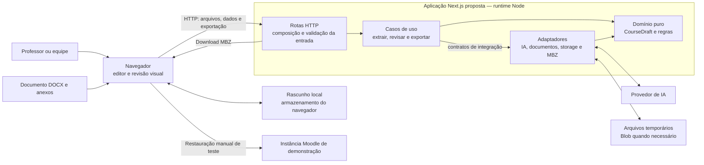
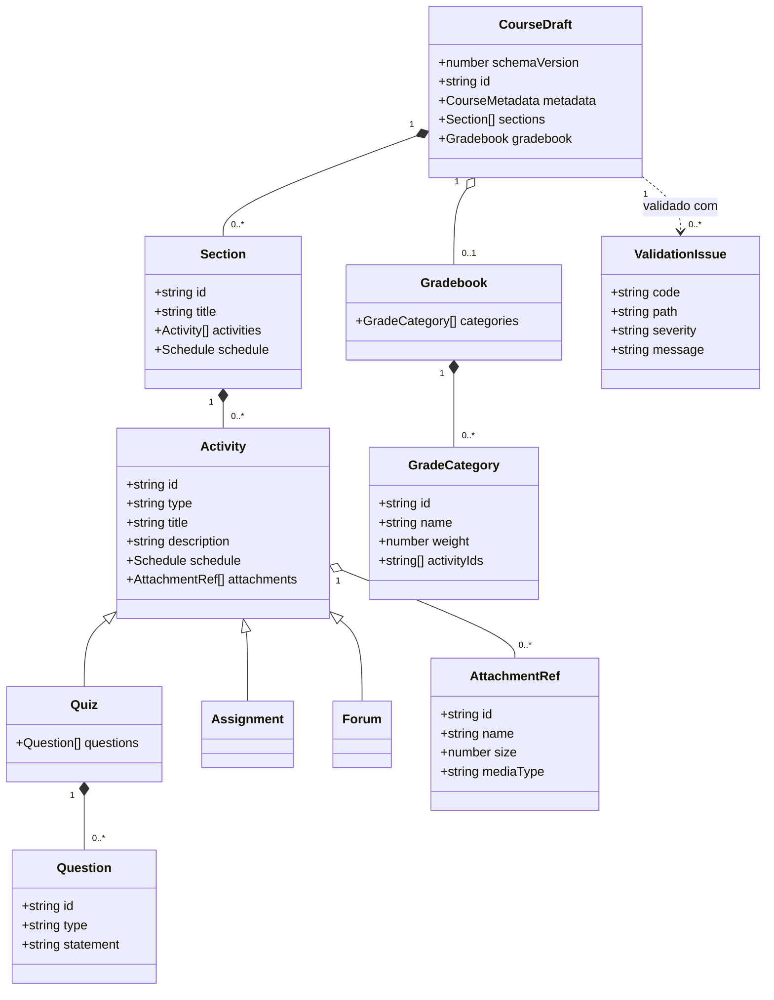
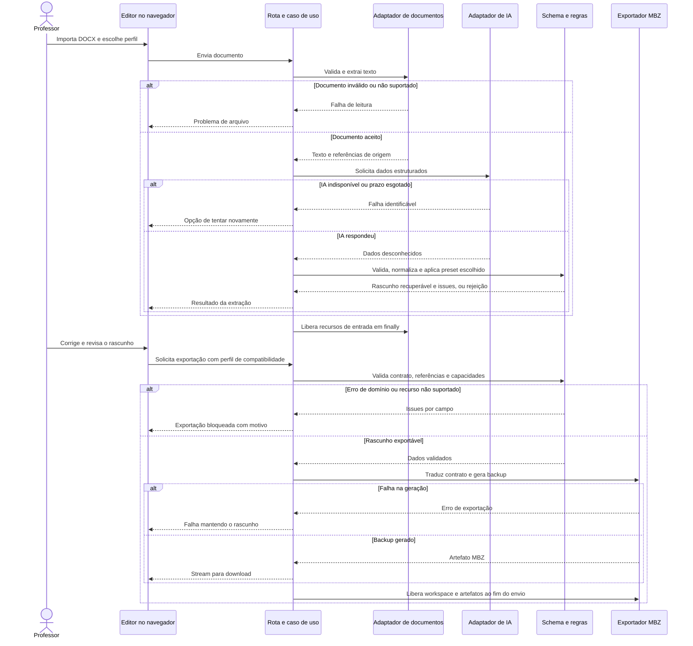

# Arquitetura proposta para Moodle AI

Moodle AI é o nome provisório de uma nova aplicação para professores e equipes prepararem cursos para Moodle com assistência de IA. O MVP concentra o fluxo documento DOCX → extração → revisão visual → backup MBZ. Documentos organizados por tópicos e por semanas fazem parte da entrega, com dois perfis de importação e fixtures distintas. O curso precisa preservar várias atividades do mesmo tipo na mesma seção.

As decisões abaixo são propostas de implementação. O projeto atual permanece como referência; os componentes reaproveitados serão incorporados à nova pasta e protegidos por seus testes. A demonstração depende de tornar as regras pedagógicas explícitas e opcionais no exportador e de validar a restauração no Moodle escolhido para a apresentação.

## Limites do MVP

O usuário importa um documento dentro de um formato suportado, revisa os dados extraídos, resolve problemas e baixa um curso. A IA organiza informação; validações, associação de arquivos e referências Moodle são determinadas pelo código. Dados ausentes ficam ausentes ou geram pendências. Um preset só acrescenta regras quando escolhido, e a revisão identifica essa origem.

O aceite do MVP segue o [PRD](PRD.md) e o [backlog](BACKLOG.md): as duas fixtures documentais percorrem o fluxo completo, e uma seção com dois quizzes, duas tarefas e dois fóruns preserva todas as atividades até a restauração. Restrições temporárias do adapter inicial não substituem esse aceite.

Cadastro em lote, edição de cursos publicados e publicação automática ficam fora do fluxo principal inicial. Não haverá promessa de suporte a qualquer documento, versão Moodle, formato de curso ou plugin. Cada perfil de compatibilidade declara seu conjunto de capacidades e o alvo em que foi validado.

## Contexto e containers propostos

O navegador apresenta o editor e guarda rascunhos locais. Uma aplicação Next.js com TypeScript entrega a interface e expõe as rotas HTTP. O runtime Node executa extração e exportação. Adaptadores isolam provedor de IA, arquivos temporários, armazenamento de uploads e escrita do backup. Um banco de dados não é necessário para o MVP.



O desenho mostra responsabilidades internas ao mesmo processo, não serviços separados. O navegador nunca importa filesystem, gerador MBZ ou cliente autenticado Moodle.

Os três diagramas Mermaid deste planejamento modelam a v2 proposta. Um grafo factual de imports e dependências da base pode ser extraído posteriormente com CodeGraph e usado para conferir a migração; ele é um artefato diferente destes modelos.

## Direção das dependências

| Camada | Pode depender de | Responsabilidade |
|---|---|---|
| Domínio | Funções puras e schema compartilhado | Dados, normalização e regras determinísticas |
| Interface | Domínio e cliente HTTP | Estado da revisão e componentes visuais |
| Casos de uso | Domínio e contratos de adaptadores | Coordenar extração, verificação e exportação |
| Adaptadores | Domínio, contratos e bibliotecas externas | Traduzir integrações e formatos |
| Rotas HTTP | Casos de uso e adaptadores concretos | Montar dependências, validar transporte e responder |

As rotas são a composição das dependências. Um caso de uso recebe as poucas integrações necessárias por parâmetro; não precisa de um container de injeção. A chamada runtime do caso de uso ao adaptador não implica importar uma biblioteca do provedor dentro do domínio.

O contrato compartilhado precisa ser utilizável no navegador. Utilitários puros de categorias, datas e validação não podem carregar `crypto`, `fs`, APIs Next ou SDKs de IA. A dependência da interface em um schema não autoriza importar todo o módulo de servidor.

## Módulos com interface pequena

Um **Module** reúne comportamento atrás de uma **Interface** pequena, que inclui parâmetros, invariantes, falhas e ciclo de vida. **Depth** significa esconder decisões relevantes de quem chama. Extração e exportação devem concentrar essas decisões, com funções de coordenação curtas. Essa direção segue a skill [codebase-design de Matt Pocock](https://raw.githubusercontent.com/mattpocock/skills/main/skills/engineering/codebase-design/SKILL.md).

Uma **Seam** só entra quando o comportamento varia: extração terá **Adapter** Gemini e fake determinístico; recursos de arquivo terão **Adapter** em memória e real. Os dois caminhos devem exercer a mesma **Interface**. Exportação esconde filesystem e XML; validação permanece uma função pura. Wrappers que apenas encaminham chamadas ou contratos de integrações futuras não justificam novas camadas.

| Interface proposta | Comportamento concentrado |
|---|---|
| `extractCourse` | Leitura do documento, escolha do perfil, chamada à IA e resultado validado |
| `validateDraft` | Problemas estruturais e regras por campo, sem efeitos externos |
| `exportCourse` | Capacidades do perfil, resolução dos anexos, tradução ao legado e artefato para download |

O fake de IA recebe entradas e devolve casos determinísticos, inclusive respostas incompletas. O resolver de arquivos em memória devolve bytes e metadados para fixtures; o real resolve uploads e devolve o mesmo formato. Apenas o exportador legado materializa os bytes em temporários, sem expor caminhos a seus chamadores. Dependências são recebidas por parâmetro onde esses caminhos variam.

## Contrato CourseDraft proposto

`CourseDraft` é o formato interno único da extração, criação manual, revisão, persistência e exportação. A versão inicial terá `schemaVersion: 1`, metadados do curso, `sections[]` e `sections[].activities[]`. O MVP exige múltiplas atividades por seção; o perfil entregue precisa suportar pelo menos dois quizzes, duas tarefas e dois fóruns na mesma seção. Cada exportador declara as demais combinações e tipos que aceita.

IDs de curso, seção, atividade, questão e anexo são estáveis durante a edição. Alterar ordem, título ou nome de arquivo não muda a associação. Esses IDs são identidades do rascunho; os IDs numéricos de backup Moodle são alocados separadamente pelo modelo de exportação.

Atividade usa uma união discriminada por `type`, começando pelo conjunto efetivamente suportado no MVP. Questões também possuem tipo explícito. Campos pedagógicos opcionais não são criados pelo formato de exportação. A ordem das listas define a apresentação; o número da aula é um rótulo, não uma chave de associação.

Anexos são `AttachmentRef` com ID opaco, nome de exibição, tamanho e tipo de conteúdo. O JSON público não contém `filePath`, diretório temporário, segredo ou credencial. O adaptador de arquivos resolve os IDs para os recursos físicos durante a exportação e mantém esses detalhes no servidor.



O diagrama representa um recorte do domínio, não uma lista definitiva de todos os módulos Moodle. `GradeCategory.activityIds` expressa associação explícita; o exportador traduz essa intenção ao livro de notas suportado.

## Validação e resultados por campo

O schema valida entradas e saídas em runtime. A resposta da IA começa como dado desconhecido: reparar sintaxe JSON não comprova conformidade. O mesmo contrato valida importação, carregamento de rascunho e pedido de exportação. A versão identifica quais migrações de rascunho são possíveis; versão desconhecida retorna uma mensagem acionável.

Após validar a estrutura, regras de domínio verificam datas, referências, anexos, categorias e conteúdo obrigatório. A exportação acrescenta as limitações do perfil de compatibilidade. O resultado proposto contém o rascunho quando recuperável e uma lista `issues` com `code`, `path`, `severity` e `message`.

Um problema pode apontar para `sections[0].activities[1].title`, enquanto a interface usa o ID da atividade para manter o foco após reordenação. Erros bloqueiam a exportação; avisos exigem revisão visível conforme sua regra. A interface explica o que corrigir no campo correspondente, sem depender de uma falha tardia dentro do gerador.

Valores extraídos, informados pelo usuário e aplicados por preset possuem origem identificável. A proposta não usa percentuais de confiança inventados pelo modelo. Um trecho de origem, quando disponível, pode sustentar a revisão de uma informação.

## Pipeline e falhas propostas



Retries do provedor respeitam um orçamento de tempo menor que o limite da requisição. Cada arquivo temporário entra no registro de limpeza assim que é criado, mesmo se o restante da coleta falhar. Geração e stream têm responsabilidades distintas: workspace de geração some no `finally`; o artefato final permanece até terminar ou falhar o envio. O draft associa anexos a IDs persistentes pelo prazo do rascunho, e a exportação cria cópias temporárias; a limpeza dessas cópias não apaga a associação do usuário.

## Três perfis independentes

| Perfil proposto | Define | Não define |
|---|---|---|
| Importação `docx-topicos-v1` e `docx-semanal-v1` | Seções por tópicos ou semanas e mapeamento ao CourseDraft, ambos no MVP | Pesos inventados, atividades obrigatórias e XML Moodle |
| Pedagogia `base` ou `personalizado` | Categorias, pesos, frequência, avaliação final, blocos e títulos que o usuário escolheu aplicar | Parser do documento e compatibilidade de backup |
| Compatibilidade proposta `moodle-backup-4.1-topics-v1` | XML, referências, metadados de backup, formato de curso e capacidades a validar | Regras pedagógicas obrigatórias |

`docx-topicos-v1` interpreta documentos que identificam tópicos e suas atividades. `docx-semanal-v1` interpreta organização por semanas, períodos e atividades distribuídas no cronograma. Os dois pertencem ao MVP e terão documentos representativos, fixtures e revisão do mapeamento. Sua implementação pode ser sequencial, mas V05 exige ambos e V06 valida a restauração dos dois resultados. A arquitetura aceita perfis por configuração e funções pequenas, sem exigir um sistema de plugins.

O preset `personalizado` conserva o que foi informado. O preset `base` oferece uma organização neutra que o usuário pode escolher e revisar. Avaliação final, controle de faltas e blocos de encontros só entram quando configurados. Nome da categoria do curso, títulos e metadados de origem deixam de ser literais globais.

O perfil de compatibilidade registra versão própria, conjunto de atividades e formato de curso suportados. `moodle-backup-4.1-topics-v1` é uma proposta inicial baseada no formato emitido pela base; sua aceitação depende dos testes e da restauração no ambiente de demonstração. A versão Moodle declarada no backup pertence ao formato produzido, não é um campo livre que o usuário troca para obter compatibilidade. Atualizar apenas `<moodle_release>` não adapta XML, referências ou módulos.

## Estrutura de pastas proposta

```text
Moodle-AI/
  src/
    app/                         páginas, layouts e rotas HTTP
    features/
      course/                    fluxo, componentes e estado da revisão
    components/
      ui/                        controles e tokens compartilhados
    domain/
      course/                    contrato versionado, schema e regras puras
    profiles/
      import/                    DOCX por tópicos e por semanas no MVP
      pedagogy/                  presets explícitos
    server/
      use-cases/                 extrair curso e exportar curso
      ports/                     contratos onde já existem dois adaptadores
      adapters/
        ai/                      provedor real e fixture de demonstração
        documents/               leitura DOCX e recursos temporários
        storage/                 uploads e resolução de AttachmentRef
        moodle/
          legacy/                núcleo incorporado da base
          compatibility/         capacidades e metadados versionados
          toLegacyCourse.ts      tradução validada
  tests/
    fixtures/                    documentos e drafts sem dados privados
    integration/                 pipeline e contrato de exportação
    e2e/                         revisão e download
  docs/
    ARCHITECTURE.md
```

Os caminhos descrevem a implementação proposta. Não pressupõem que fonte, dependências ou testes já existam na nova pasta. Novas features só ganham diretório quando entrarem no escopo.

## Decisões propostas em formato ADR

### ADR 001 Monólito modular com Next e TypeScript

**Contexto:** um participante precisa desenvolver, revisar e apresentar um fluxo completo, com subagents trabalhando por contratos claros. **Decisão proposta:** uma aplicação Next com domínio puro e adaptadores. **Alternativa:** frontend e API separados, ou microserviços. **Tradeoff:** reduz operação e integração, mas extração e exportação compartilham limites do runtime. Uma fila só será considerada se volume ou duração medidos exigirem execução fora da requisição.

### ADR 002 Contrato único com validação em runtime

**Contexto:** o legado aceita JSON por cast e tem divergência entre atividades singulares e arrays. **Decisão proposta:** CourseDraft versionado com `sections[].activities[]`, IDs estáveis e issues por campo. **Alternativa:** manter tipos independentes na tela, prompt e exportador. **Tradeoff:** exige um adapter inicial, mas torna incompatibilidades explícitas e permite evoluir o editor sem depender do formato XML.

### ADR 003 Reaproveitar o gerador através de adapter

**Contexto:** o núcleo contém conhecimento e testes de referências Moodle; reescrever XML consumiria o prazo do hackathon. **Decisão proposta:** incorporar o núcleo à nova pasta, preservando testes e traduzindo o domínio para seu formato de entrada. **Alternativa:** reconstruir todo o gerador ou acoplar o novo editor diretamente ao formato legado. **Tradeoff:** somente a fase inicial V01–V04 pode rejeitar mais de uma atividade do mesmo tipo por seção, com erro claro; `array[0]` e qualquer truncamento silencioso são proibidos. Em V05, o core incorporado precisa alocar IDs e escrever referências para cada atividade e questão, exportando pelo menos dois quizzes, duas tarefas e dois fóruns na mesma seção. Também precisa retirar a obrigatoriedade de categorias, avaliação final, controle de faltas e blocos predefinidos. V06 restaura e confere os resultados; V07 permanece bloqueado até esse aceite. O adapter sozinho não resolve cardinalidade e inserções incondicionais internas.

### ADR 004 Perfis separados de documento pedagogia e Moodle

**Contexto:** o legado mistura estrutura documental, defaults pedagógicos e formato de backup. **Decisão proposta:** separar os três perfis e registrar suas versões no resultado da operação. **Alternativa:** um único perfil controlar todo o pipeline. **Tradeoff:** há mais uma escolha explícita de configuração, mas o mesmo documento pode usar outro preset e ser exportado por outro perfil de compatibilidade sem redefinir o domínio.

### ADR 005 Rascunho local e exportação sob demanda

**Contexto:** o MVP não exige colaboração simultânea, contas próprias ou histórico compartilhado. **Decisão proposta:** rascunho local versionado e arquivos resolvidos pelo adaptador, com duração de retenção explícita. **Alternativa:** banco e autenticação próprios desde o início. **Tradeoff:** o rascunho fica no navegador/dispositivo; portabilidade requer exportação e importação do draft. Compartilhamento entre professores é evolução posterior, não uma capacidade implícita do MVP.

## Fase inicial e entrega do MVP

| Etapa | Trabalho de arquitetura | Saída necessária |
|---|---|---|
| V01–V03 — integração inicial | Definir contrato e schema, incorporar core/testes, criar adapter, editor manual e persistência versionada | Drafts válidos geram backups verificáveis; recursos ainda não suportados são rejeitados claramente |
| V04 — pipeline de IA | Ler DOCX, chamar IA ou fake e validar resposta antes do editor | Sucesso e falhas de interpretação preservam revisão e recuperação; multiplicidade ainda pode ser bloqueada pelo adapter temporário |
| V05 — capacidades do MVP | Implementar ambos os perfis DOCX, presets opcionais e exportação de múltiplas atividades | Fixtures por tópicos e semanas são exportáveis; uma mesma seção preserva pelo menos dois quizzes, duas tarefas e dois fóruns |
| V06 — prova de restauração | Restaurar os dois pacotes em cursos novos e vazios; conferir o conteúdo contra os drafts | Versão, módulos, opções de restauração e resultado registrados; perdas ou divergências bloqueiam o aceite |
| V07 — apresentação pública | Reunir evidências, concluir gates do backlog e verificar ambiente limpo, build e jornada no navegador | Demo/deploy liberados somente após V05, V06 e os gates necessários estarem concluídos |

Em V05, o modelo de exportação precisa representar cada atividade e questão com IDs próprios. Descritores, writers, sequências de seção, banco de questões, notas e referências de arquivos devem consumir o mesmo mapa de IDs. A migração também extrai regras pedagógicas e retira defaults obrigatórios; seções opcionais não podem deixar referências pendentes. Testes verificam a contagem e a integridade de todas as atividades, e V06 verifica seu conteúdo após restauração.

Cada etapa mantém uma saída revisável. V01–V04 permitem verificar a integração inicial; não constituem o MVP entregue. A extração automática e a criação manual devem produzir o mesmo contrato. A revisão precisa mostrar tudo que será exportado. A compatibilidade não pode esconder atividades ou inventar regras pedagógicas. Se V05 ou V06 falharem, a restrição provisória de multiplicidade não pode ser apresentada como escopo final nem liberar V07.

## Evidências de restauração

O perfil deve registrar o formato de backup emitido e o conjunto de módulos testado. A validação inclui uma restauração real e documenta a versão da instância de destino, módulos/formato habilitados, opções de restauração e resultado observado.

Os cursos restaurados das fixtures por tópicos e semanas devem preservar seções, atividades, textos, questões, anexos, datas e livro de notas dentro das capacidades declaradas. A conferência inclui uma seção com pelo menos dois quizzes, duas tarefas e dois fóruns, verificando contagem, conteúdo e referências de cada atividade. Testes locais de XML e integridade de referências complementam essa restauração; não a substituem. Novas versões de Moodle ou plugins entram como alvos a validar, não como compatibilidade presumida.

## Evidências da base legada

| Achado | Evidência no projeto de referência | Consequência para a proposta |
|---|---|---|
| Arrays múltiplos emitidos, mas gerador lê singulares | [BuilderStep.tsx](../../CourseGen-AI/ui/app/components/BuilderStep.tsx), linhas 697 a 720; [model.js](../../CourseGen-AI/ui/server/mbzGenerator/model.js), linhas 149 a 179; [activityWriter.js](../../CourseGen-AI/ui/server/mbzGenerator/activityWriter.js), linhas 19 a 94 | Contrato uniforme e erro de capacidade antes de gerar |
| JSON da revisão tem cast; rota valida principalmente sintaxe | [ReviewStep.tsx](../../CourseGen-AI/ui/app/components/ReviewStep.tsx), linhas 24 a 50; [generate route](../../CourseGen-AI/ui/app/api/generate/route.ts), linhas 91 a 109 | Validação runtime compartilhada |
| Normalização de categorias duplicada | [GradebookEditor.tsx](../../CourseGen-AI/ui/app/components/GradebookEditor.tsx), linhas 21 a 45; [model.js](../../CourseGen-AI/ui/server/mbzGenerator/model.js), linhas 198 a 211 | Regras puras únicas no domínio |
| Associação de anexos depende do nome e de contadores | [ReviewStep.tsx](../../CourseGen-AI/ui/app/components/ReviewStep.tsx), linhas 31 a 40; [generate route](../../CourseGen-AI/ui/app/api/generate/route.ts), linhas 98 a 105 | IDs e referências explícitas de anexos |
| Prompt aplica defaults pedagógicos e exige avaliação final | [extractor.js](../../CourseGen-AI/ui/server/extractor.js), linhas 138 a 154 | Separar extração de preset pedagógico |
| AF, Faltas e blocos são gerados incondicionalmente | [model.js](../../CourseGen-AI/ui/server/mbzGenerator/model.js), linhas 100 a 101 e 179; [activityWriter.js](../../CourseGen-AI/ui/server/mbzGenerator/activityWriter.js), linhas 13 a 16; [index.js](../../CourseGen-AI/ui/server/mbzGenerator/index.js), linhas 368 a 407 | Parametrizar core antes da demo genérica |
| Origem, categoria do curso e versões de backup fixas | [index.js](../../CourseGen-AI/ui/server/mbzGenerator/index.js), linhas 151 a 162 e 252 a 254 | Metadados e perfil de compatibilidade versionados |
| IDs principais centralizados; offsets auxiliares ainda espalhados | [model.js](../../CourseGen-AI/ui/server/mbzGenerator/model.js), linhas 33 a 75; [index.js](../../CourseGen-AI/ui/server/mbzGenerator/index.js), linha 97; [activityWriter.js](../../CourseGen-AI/ui/server/mbzGenerator/activityWriter.js), linhas 175 a 178; [builders.js](../../CourseGen-AI/ui/server/mbzGenerator/builders.js), linhas 240 a 259 | Migrar referências com testes antes de expandir multiplicidade |
| Core já testa categorias e referências do backup | [generator.test.js](../../CourseGen-AI/ui/server/mbzGenerator/generator.test.js), linhas 107 a 175; [builders.test.js](../../CourseGen-AI/ui/server/mbzGenerator/builders.test.js), linhas 13 a 60 | Preservar regressões ao incorporar o exportador |

## Glossário

| Termo | Significado neste projeto |
|---|---|
| CourseDraft | Rascunho canônico, independente do provedor de IA e do XML Moodle |
| Section | Seção ordenada do curso com identidade estável |
| Activity | Atividade tipada e revisável dentro de uma seção |
| AttachmentRef | Identificador de anexo sem caminho físico no JSON público |
| Perfil de importação | Regras para interpretar um formato de documento |
| Preset pedagógico | Convenções de organização e avaliação escolhidas pelo usuário |
| Perfil de compatibilidade | Formato e capacidades de exportação declarados e validados |
| Module — módulo | Comportamento apresentado por uma Interface |
| Interface — interface | O que chamadores e testes precisam conhecer |
| Depth — profundidade | Comportamento útil por superfície apresentada |
| Seam — ponto de substituição | Local onde uma implementação pode variar |
| Adapter — adaptador | Implementação concreta que atende à Interface |
| MBZ | Artefato de backup usado na restauração de curso Moodle |
| ADR | Registro de contexto, decisão, alternativa e tradeoff de arquitetura |
