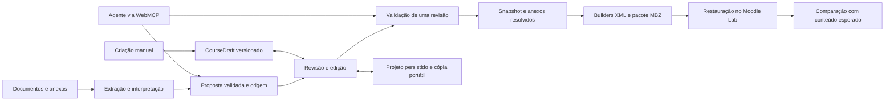

# Plano da pipeline do Moodle Builder

**Proposta de 12 de outubro de 2026. Estado: planejamento, sem implementação da aplicação.**

A nova versão será um builder de cursos Moodle com assistência de IA, preservando o trabalho já atendido pelo CourseGen-AI: preparação de disciplinas, arquivos MBZ, cadastro em lote e manutenção de datas. A prioridade técnica é tornar o curso editado, o curso exportado e o curso restaurado semanticamente equivalentes. A IA propõe conteúdo; regras de código validam; a pessoa revisa; o exportador traduz para o Moodle.

O projeto deverá permitir desenvolvimento por outras pessoas, uso de diferentes provedores de IA e projetos recuperáveis por exportação e importação completas. O usuário escolheu persistência somente no navegador para esta versão. WebMCP acrescenta uma forma de agentes operarem o builder pela página, usando as mesmas operações do editor.

## Relação com o planejamento existente

O [PRD](PRD.md), a [arquitetura](ARCHITECTURE.md) e o [backlog](BACKLOG.md) descrevem uma primeira demonstração centrada na criação de cursos. Este plano amplia a visão da versão completa solicitada agora. Alunos, envio de cadastro e datas continuam no escopo da versão; a ordem de entrega não deve ser interpretada como exclusão desses recursos.

As mudanças propostas em relação aos documentos anteriores são:

| Tema | Proposta anterior | Direção deste plano |
| --- | --- | --- |
| Público do desenvolvimento | Participante solo e subagentes | Mantenedor, contribuidores humanos e agentes, com reprodução local e contratos claros |
| Persistência | Rascunho no navegador, exportação JSON | Projeto no navegador e pacote completo portátil com anexos; sem banco ou contas exigidos |
| IA | Gemini real e fake | Pelo menos dois provedores reais e fake, com o mesmo contrato de resultado |
| Operações antigas | Evoluções depois do MVP | Entregas obrigatórias para declarar a versão completa com paridade |
| Confiança no MBZ | Restauração no final da demonstração | Laboratório desde a primeira exportação e regressão contínua |
| Automação por agentes | Processo de desenvolvimento | Também ferramentas WebMCP opcionais dentro da aplicação |

Os documentos existentes permanecem como base; as decisões aprovadas deste plano deverão ser reconciliadas neles antes da implementação. A direção visual segue na outra conversa. A orientação de [AGENTS.md](../AGENTS.md) de não iniciar código continua aplicável.

## Escopo antigo a preservar e melhorar

O inventário considera código existente, capacidade exposta e lacunas. Existência de um writer ou teste antigo não comprova suporte na nova aplicação.

| Trabalho | Base legada | Melhoria e aceite da nova versão |
| --- | --- | --- |
| Criar disciplina por documento, JSON ou edição manual | `extractor.js`, telas de upload/revisão e `BuilderStep.tsx` | Todas as entradas convergem para o mesmo curso; a criação manual funciona sem IA |
| Usar outra IA por prompt copiável | Copiar prompt e exemplo, gerar JSON fora da aplicação e retornar à revisão | Prompt genérico versionado com schema/perfis escolhidos; resposta externa recebe a mesma validação e revisão da IA interna |
| Conferir documentos de origem | Visualização de DOCX e PDF no `FileViewer` | Manter prévia segura dos dois formatos; visualizar PDF não significa interpretar qualquer PDF como planejamento |
| Aulas, atividades e questões | Fórum, quiz, chat, wiki, glossário e tarefa; questões de múltipla escolha, associativa V/F e discursivas | Manter os seis tipos na matriz da versão completa, com configuração declarada; várias atividades por seção, inclusive chat e tarefa juntos |
| Recursos pedagógicos | Mural, apresentação, professor/tutor, agenda, encontros virtuais/gravações e suas avaliações, frequência, faltas, avaliação final, bibliografia, notas/categorias e blocos | Preservar essas possibilidades como escolhas explícitas, sem impor o padrão institucional a todos os cursos |
| DOCX complementares e arquivos | Leitura de tarefas/quizzes, associação por nome, uploads e anexos | Mostrar proposta de associação; usuário corrige o destino; vínculo final por ID e bytes realmente disponíveis |
| Imagens incorporadas às matrizes | O parser atual extrai texto/equações; a prévia documental não comprova exportação das imagens | Preservar bytes, ocorrência e vínculo ao conteúdo desde importação até projeto portátil e curso restaurado; imagem ausente é pendência bloqueante quando exigida pelo conteúdo |
| Salvar e retomar | Histórico JSON em localStorage e arquivos em IndexedDB | Reabrir conteúdo e anexos em outro navegador; versões antigas recebem migração ou diagnóstico |
| Cadastro em lote | XLS/XLSX/CSV → mapeamento IA → revisão → CSV, inclusive por curso | Preservar linha e valores originais; validação determinística de CPF/e-mail após edição; revisão e configuração dos campos Moodle |
| Enviar cadastro ao Moodle | Upload, prévia e confirmação pelo fluxo Moodle | Prévia vinculada ao CSV/opções; resultado por aluno, tratamento de atualização e repetição; teste local |
| Ajustar datas de turmas existentes | Calendário/cadência, simulação e aplicação por turma | Mostrar antes/depois; edição invalida a simulação; preservar configurações e relatar resultado parcial |
| Sugestões de turmas e catálogo | Núcleos `sugestaoTurmas.js` e `moodle/catalogo.js` com testes | Avaliar integração: não foram encontrados consumidores na UI/rotas durante o inventário; não anunciar fluxo pronto |

Referências do inventário: [instruções do legado](../../CourseGen-AI/AGENTS.md), [editor manual](../../CourseGen-AI/ui/app/components/BuilderStep.tsx), [exportador](../../CourseGen-AI/ui/server/mbzGenerator/index.js), [cadastro](../../CourseGen-AI/ui/server/alunos.js) e [armazenamento de arquivos](../../CourseGen-AI/ui/app/lib/fileStore.ts). O núcleo existente será incorporado à nova aplicação quando a execução for liberada; a pasta CourseGen-AI permanece referência.

A questão associativa V/F do legado é exportada como `match`, não como o tipo Moodle `truefalse`. A paridade deve declarar esse mapeamento, junto de `multichoice` e `essay`, e conferir fórmulas/textos e feedback das fontes. Adicionar outro tipo requer capacidade e fixture próprias. Fonte: [builders de questões](../../CourseGen-AI/ui/server/mbzGenerator/builders.js).

Os fluxos de IA externa e visualização estão expostos em [CopyPromptButton](../../CourseGen-AI/ui/app/components/CopyPromptButton.tsx), [rota de prompt](../../CourseGen-AI/ui/app/api/prompt/route.ts) e [FileViewer](../../CourseGen-AI/ui/app/components/FileViewer.tsx). O aceite da prévia inclui leitura dos dois formatos e conteúdo sem execução de scripts/URLs ativas não permitidas, preservando consulta à fonte durante a revisão.

## Modelo de projeto e pipeline de produção

O vocabulário está no [glossário](../GLOSSARY.md). O `CourseDraft` versionado da arquitetura continua sendo o único contrato do curso. Um projeto reúne esse rascunho, fontes, anexos, perfis e histórico necessário para retomá-lo. O projeto editável e o backup Moodle têm finalidades diferentes.

Sequência proposta:

1. Receber documentos/anexos ou comandos de criação manual, verificando tipo, tamanho, quantidade e propriedade dos arquivos.
2. Extrair texto, tabelas, imagens incorporadas e referências de origem; manter o documento original e os arquivos de mídia. Um documento não reconhecido produz pendências, sem curso vazio considerado bem sucedido.
3. Interpretar conforme perfil de importação e provedor escolhido. A resposta da IA é dado desconhecido até passar por schema e regras.
4. Produzir proposta revisável. Ausência, ambiguidade e associações sugeridas ficam localizadas; texto do documento não pode mudar as instruções da aplicação.
5. Editar o mesmo `CourseDraft` por comandos tipados, preservando identidade de seção, atividade, questão e anexo. Cada alteração gera nova revisão.
6. Validar estrutura, regras e capacidades do perfil Moodle. Erros bloqueiam exportação; avisos mostram motivo e consequência.
7. Gerar de um snapshot identificado e resolver anexos autorizados. Alterar o editor durante o job não altera esse snapshot nem transforma o pacote antigo na exportação da revisão nova.
8. Produzir XML e referências por código determinístico, compactar e disponibilizar o artefato identificado pela revisão.
9. Na pipeline de desenvolvimento, restaurar fixtures no laboratório e comparar resultados. Para o uso normal, validar cada exportação sem exigir que cada professor rode um Moodle local.

O monólito modular proposto continua adequado como ponto de partida. Extração e exportação recebem dependências; domínio e regras de notas/datas permanecem puros, utilizáveis no servidor e no editor. Persistência somente no navegador não impede processamento transitório no backend para IA/MBZ, já existente no legado; esse processamento não se torna repositório dos projetos. A escolha não exige execução de todos os parsers/SDKs/geradores dentro do navegador.

Um worker só entra quando medições de duração/tamanho justificarem. Se essa evolução for necessária, especificar consulta/recuperação do job e retenção transitória sem introduzir armazenamento permanente de cursos por inferência. O projeto local permanece recuperável quando o processamento falha.

Interfaces pequenas propostas: `interpretDocuments`, `validateDraft`, `exportCourse` e `save/loadProject`. UI, rotas e WebMCP reutilizam os mesmos casos de uso. Contratos detalhados serão especificados na fatia correspondente; este plano não cria um schema concorrente ao `CourseDraft`.

## Regressões conhecidas e invariantes do MBZ

| Problema observado por leitura do legado | Regra e caso de aceite |
| --- | --- |
| Builder emite arrays plurais; gerador lê campos singulares | Uma seção com dois quizzes, duas tarefas e dois fóruns mantém todos até a restauração; não usar primeiro elemento nem truncamento |
| Tarefa só é emitida quando não há chat | Chat e tarefa na mesma seção preservam ambas as atividades ou produzem incompatibilidade explícita antes de gerar |
| Tipo desconhecido de questão vira discursiva | Rejeitar/localizar tipo não suportado; nunca converter silenciosamente |
| Categorias normalizadas no cliente e servidor por cópias distintas | Uma regra pura de notas e vínculos serve a editor, validação e exportação |
| Anexo manual pode conter apenas nome/tamanho | Arquivo só conta como presente com bytes resolvíveis, hash e vínculo; nome sozinho gera pendência |
| JSON do cliente pode carregar `filePath` | Rejeitar caminhos físicos no contrato público; resolver apenas IDs de anexos autorizados para o projeto |
| Documento grande é dividido e o merge perde campos | Reconciliação preserva todas as partes e origens; perda/ambiguidade produz problema visível |
| Falha de quiz complementar pode aparecer apenas no console | Falha por documento/atividade chega à revisão; não apresentar importação incompleta como completa |
| Recurso temporário pode surgir antes do bloco de limpeza | Registrar no instante da criação; falhas em cada etapa e cancelamento devem liberar recursos transitórios |

As regras de IDs e referências permanecem concentradas no modelo de exportação. Builders XML recebem dados e retornam XML, sem disco nem rede. O mapa de IDs alimenta seções, módulos, questões, notas e arquivos. O Moodle pode remapear IDs ao restaurar; o teste compara relações e conteúdo, sem exigir igualdade de IDs numéricos.

Preservar a ordem das atividades, vínculos do livro de notas, datas e conteúdo dos anexos. Uma combinação de atividade/plugin/versão não suportada deve bloquear essa exportação com diagnóstico localizado. Mudar apenas o número da versão no cabeçalho do backup não cria compatibilidade.

## Preservação de imagens das matrizes

**Requisito reforçado pelo usuário em 12 de outubro de 2026:** imagens necessárias ao conteúdo não podem desaparecer ao interpretar a matriz, editar, salvar, exportar o projeto ou restaurar o MBZ. Guardar apenas o DOCX original ou mostrar a imagem na prévia não satisfaz esse requisito.

O [parser legado](../../CourseGen-AI/ui/server/parser.js) lê `word/document.xml` e retorna texto/equações, sem extrair os arquivos de imagem e seus relacionamentos. A nova importação precisa tratar as mídias como conteúdo do projeto, independente da capacidade visual da IA.

- Extrair imagens incorporadas e seus relacionamentos, registrando arquivo original, ID estável, tipo, tamanho, hash e referência ao local da fonte, incluindo bloco, linha/célula de tabela e relação DOCX. Imagens externas indisponíveis e formatos não processáveis recebem diagnóstico visível.
- Preservar cada ocorrência na ordem relativa do texto/tabela, mantendo a estrutura de linhas/células quando necessária ao significado, com vínculo à seção, descrição, questão, alternativa ou feedback pertinente. Um mesmo arquivo pode aparecer várias vezes; deduplicar bytes não pode apagar ocorrências. Guardar legenda, texto alternativo e propriedades de apresentação necessárias, incluindo recorte/rotação quando afetarem a leitura.
- Representar conteúdo com referências às mídias no contrato canônico; a IA não deve devolver URLs inventadas, recriar a figura ou substituir a imagem por uma descrição/OCR. Quando uma figura for necessária à interpretação, usar provedor com visão ou sinalizar revisão manual, mantendo a figura original em ambos os casos.
- Mostrar imagens no editor junto do conteúdo e permitir corrigir associações. Registrar todas as imagens detectadas e seus destinos; descarte intencional exige uma ação explícita do usuário. Uma imagem necessária sem bytes ou sem destino definido bloqueia a exportação.
- Persistir bytes no IndexedDB e incluir imagens e ocorrências na cópia portátil. URLs de `blob:` ou links transitórios servem à exibição, sem substituir os arquivos e IDs que precisam sobreviver à reimportação.
- No MBZ, gravar os arquivos e suas referências no contexto/componente/área apropriados ao conteúdo e ao Moodle alvo. Reescrever referências incorporadas para o mecanismo Moodle, como `@@PLUGINFILE@@`, quando aplicável. Um arquivo em anexo de tarefa não garante que uma imagem no enunciado de questão apareça.

O mapeamento deve seguir a [File API Moodle](https://moodledev.io/docs/5.0/apis/subsystems/files) da versão alvo. Conversão necessária para formato suportado conserva o original no projeto e informa a transformação; não comprimir ou reduzir resolução silenciosamente quando houver perda de legibilidade. A intenção é preservar conteúdo e apresentação significativa, sem prometer reprodução idêntica da paginação do Word.

Aceite: fixture fictícia com figura na matriz, figura dentro de tabela e imagem no enunciado de uma questão, incluindo duas ocorrências do mesmo arquivo. Conferir imagem e posição significativa no editor; exportar o projeto, limpar os dados locais e reimportar; gerar/restaurar o MBZ; verificar renderização no Moodle e bytes/hashes dos originais, além de todas as ocorrências e vínculos. Referência quebrada, figura ausente ou transformação ilegível impede o aceite. Incluir falha de extração e escolha de IA sem visão para comprovar diagnóstico e preservação.

## Prompts genéricos e perfis institucionais

O perfil documental de referência continua sendo um caso atendido. Sua Matriz DE e suas convenções serão um perfil de importação e um preset pedagógico versionados, em vez de regras globais.

| Parte | Responsabilidade |
| --- | --- |
| Contrato e instruções de interpretação | Campos do curso, atividades, origens, tratamento de ausência e proibição de inventar informação extraída |
| Perfil documental | Como localizar e mapear os dados de Matriz DE, planejamento por tópicos ou planejamento semanal |
| Preset pedagógico escolhido | Encontros, frequência, avaliação final, categorias/pesos, títulos e blocos desejados |
| Capacidades Moodle | O que pode ser exportado; não obriga o modelo a esconder conteúdo fora dessas capacidades |
| Intenção da tarefa | Extrair, complementar ou sugerir alteração de uma atividade identificada, com limites claros |
| Dados da fonte | Conteúdo delimitado como dados não confiáveis, com referências que sustentem a revisão |

Extração conserva o que está no documento. Geração de conteúdo novo é uma ação distinta, identifica a origem como sugestão e preserva a versão anterior para revisão. Aplicar preset em curso existente mostra diferenças e não substitui conteúdo revisado sem ação do usuário.

Salvar versões do schema, prompt, perfis, provedor e modelo utilizados. Dois documentos de estruturas diferentes e um exemplo institucional fictício devem testar se trocar o perfil altera interpretação sem alterar o contrato do curso. A instituição deixa de definir nomes, URL Moodle e metadados globais.

Avaliar resultados por campos preservados, omissões, informações inventadas, vínculos de arquivos, tipos de atividade/questão e pendências corretamente localizadas. JSON parseável ou resposta fluente não é critério de qualidade. Os resultados esperados das fixtures serão preparados independentemente do exportador e da IA.

Preservar também o caminho de copiar o prompt para outra IA. O texto copiável deve incluir contrato, versões dos perfis/preset escolhidos, instruções de origem/ausência e exemplo fictício, sem credenciais. A pessoa fornece a fonte à IA externa e importa/cola a resposta como proposta, que passa pelo mesmo schema, diagnósticos e revisão. Aceite: executar esse percurso com fixture e resposta válida, rejeitar uma resposta incompatível e permitir correção manual sem exigir chave de provedor na aplicação.

## Múltiplas inteligências artificiais

A IA interna da aplicação e o agente do navegador são integrações distintas. A primeira interpreta/gera conteúdo; a segunda chama as ferramentas do builder. WebMCP não fornece, por si só, um modelo, chave ou contrato comum aos provedores.

Começar com Gemini, por continuidade com o legado, e um segundo provedor real escolhido antes dessa fatia, além de um fake determinístico. O segundo provedor pode ser OpenAI ou Anthropic; suporte só será anunciado depois de testes do adapter. Modelo local entra quando houver demanda e avaliação de capacidade, sem necessidade para a primeira entrega.

O contrato de interpretação recebe tarefa, contexto estritamente necessário e cancelamento; retorna proposta estruturada e metadados disponíveis. Adapters isolam SDK, formato de saída, limites e erros. Suporte a saída estruturada, visão, ferramentas e streaming precisa ser declarado por capacidade, sem assumir equivalência entre modelos.

Testar sucesso, limite, timeout, cancelamento, resposta inválida/parcial e modelo indisponível com fake. Executar avaliações opcionais com provedores reais em job autorizado e com orçamento, separado da CI de contribuições. Mudar de provedor não exige outro curso, outro editor ou outro formato MBZ.

Credenciais do provedor ficam no servidor/instalação, fora do projeto portátil, ferramentas WebMCP e logs. Se houver opção de chave pessoal em aplicação hospedada, definir sua retenção antes de entregar esse fluxo. Nenhuma chave compartilhada pode ter consumo público irrestrito. Trocar automaticamente de provedor exige política explícita, porque pode mudar destino dos documentos, custo e resultado.

## WebMCP como interface opcional do builder

Em 12 de outubro de 2026, a especificação é um **Draft Community Group Report**, com entrada `document.modelContext`. Chrome documenta origin trial e ativação local; a API continua sujeita a mudanças. Registrar ferramentas por detecção de capacidade, mantendo toda a jornada manual funcional. Fontes: [spec WebMCP](https://webmachinelearning.github.io/webmcp/) e [API imperativa do Chrome](https://developer.chrome.com/docs/ai/webmcp/imperative-api).

Nomes abaixo são propostas da aplicação, não ferramentas definidas pelo padrão:

| Ferramenta | Resultado e efeito |
| --- | --- |
| `get_course_summary` | Revisão, IDs, contagens, capacidades e pendências; leitura compacta |
| `get_activity` | Conteúdo e vínculos de uma atividade autorizada, sem credenciais/caminhos internos |
| `validate_course` | Problemas localizados da revisão solicitada |
| `propose_course_changes` | Comandos por ID e `expectedRevision`; diff revisável, sem substituir o curso silenciosamente |
| `get_export_preview` | Revisão candidata, resumo, capacidades e bloqueios antes da exportação |

Aceitar propostas acontece na interface e usa o mesmo executor de comandos da edição manual. Verificar revisão e aplicar o conjunto atomicamente; `stale_revision` exige recalcular a proposta sobre o estado novo. Isso protege, por exemplo, uma tarefa que o professor mudou enquanto a IA ajustava o cronograma.

A primeira integração não expõe operações sobre contas ou cursos publicados. Essas ações passam pelo módulo operacional com escopo e prévia próprios. Não expor acesso arbitrário a arquivos, execução de código ou sobrescrita irrestrita de JSON. Annotations da ferramenta ajudam a comunicação, mas não substituem autorização e validação no servidor.

WebMCP opera na página visitada pelo agente. Um servidor MCP remoto pode ser uma entrega futura se houver necessidade de uso fora do navegador; tem transporte e ciclo de vida próprios. A separação segue o [protocolo MCP](https://modelcontextprotocol.io/specification/2026-07-28/basic/transports). A integração não pressupõe que qualquer navegador ou assistente suporte essas ferramentas.

## Persistência e portabilidade

**Decisão do usuário: somente no navegador, com exportação e importação dos projetos.** Usar IndexedDB para conteúdo e bytes de anexos, com gravação consistente; localStorage fica restrito a preferências leves. Banco, contas e sincronização entre dispositivos não fazem parte desta versão. A cópia portátil permite transportar o projeto para outro dispositivo.

O armazenamento local pode ser removido pelo navegador, pela pessoa ou por falta de espaço. A interface deve diferenciar salvo neste navegador de cópia exportada, mostrar a última exportação e facilitar uma nova cópia após mudanças. Limpar dados antes de exportar pode perder trabalho; o projeto não deve prometer recuperação do que nunca foi copiado. Persistência local durável, quando disponível no navegador, é melhoria complementar, sem substituir a cópia portátil.

A interface de salvar/reabrir recebe versão esperada e preserva consistência dos vínculos. Falha de gravação/cota mostra que a alteração ainda não foi salva; outra aba com revisão diferente não pode sobrescrever a versão mais nova silenciosamente. Regras de revisão também protegem contra propostas de IA atrasadas. Anexos persistidos ficam separados dos temporários usados pelo backend.

Formato portátil proposto: pacote ZIP com manifesto versionado, `CourseDraft`, versões e configurações efetivas dos perfis/presets utilizados, fontes/anexos necessários e hashes. Incluir presets personalizados necessários à retomada, sem depender de uma configuração disponível somente no navegador de origem. O nome/extensão será definido na especificação. Não incluir chaves, cookies Moodle, caminhos locais, planilhas de pessoas reais ou logs operacionais. Uma planilha de cadastro é outro contexto de trabalho e tem retenção própria.

Ao importar pacote, validar versão, schema, hashes, limites de tamanho descompactado e caminhos internos; impedir extração fora do destino do projeto. Não aceitar recursos dependentes de URL temporária expirada como projeto completo. Importação de JSON sem bytes continua possível, mostrando os anexos que precisam ser fornecidos.

Aceite central: criar um curso com dois anexos e preset personalizado, fechar/reabrir a aplicação, exportar o projeto, limpar os dados locais, importar a cópia em outro navegador e regenerar MBZ semanticamente equivalente, preservando também as escolhas reutilizáveis do preset. Cobrir migração de schema, arquivo ausente/corrompido e cota excedida sem apagar a versão anterior. Temporários de geração e uploads abandonados têm limpeza/expiração; anexos ligados a projetos no navegador não são apagados ao terminar uma exportação.

## Moodle Lab e comprovação de compatibilidade

Usar [moodlehq/moodle-docker](https://github.com/moodlehq/moodle-docker), ambiente oficial de desenvolvimento/testes, como base. Fixar commit do ambiente, tag/commit do Moodle, PHP, banco, imagens por digest, plugins e formato de curso. Seu código Moodle é montado separadamente; não basta iniciar uma imagem com `latest`.

A captura do ambiente de referência informa Moodle 4.1.17+, build 20250321 e versão 2022112817.01. Essa informação já foi fornecida; falta escolher o alvo e fixar o laboratório, sem confundir inventário com restauração comprovada. O legado escreve um formato 4.1; isso não comprova a versão instalada no ambiente de referência. A tabela oficial registra encerramento do suporte de segurança do 4.1 em dezembro de 2025. Caso seja o alvo necessário, usar 4.1 isolado para compatibilidade histórica e avaliar outra versão suportada como alvo adicional. Fonte: [releases Moodle](https://moodledev.io/general/releases).

Para descobrir a versão, entrar como administrador em Administração do site → Notificações. Sem acesso administrativo, solicitar à equipe responsável o número completo e os plugins/formato necessários; o link de documentação no rodapé pode indicar a família da versão, quando habilitado, mas não substitui a confirmação do patch. Fonte: [como identificar a versão Moodle](https://docs.moodle.org/503/en/Moodle_version).

O laboratório terá banco e `moodledata` próprios, porta local, credenciais fictícias, captura de e-mail e reset reproduzível. No Windows, os scripts bash do ambiente pedem Linux/WSL compatível com Docker. Nesta máquina foi encontrado Docker CLI 27.3.1, mas o daemon Linux não respondeu; o laboratório ainda precisa ser preparado.

Antes de fechar o perfil de compatibilidade, levantar no ambiente de referência a versão completa do Moodle, formato dos cursos, módulos/tipos de questão utilizados e plugins necessários com nome técnico, versão, dependências e estado habilitado. A lista administrativa fica em Administração do site → Plugins → Visão geral dos plugins, com versões e disponibilidade. Sem permissão administrativa, pedir esse inventário à equipe responsável; a aparência de uma tela não comprova a lista instalada. Fonte: [visão geral dos plugins](https://docs.moodle.org/503/en/Installing_plugins#Plugins_overview).

Distinguir plugin instalado, plugin habilitado e plugin realmente necessário para os cursos gerados. Incluir filtros de fórmulas/mídias e formato de curso quando o conteúdo depender deles. O laboratório reproduz apenas o conjunto necessário, com versões fixadas e obtenção/configuração possíveis; plugin privado ou indisponível permanece como capacidade não validada. Plugin requerido ausente recebe erro localizado e não pode ser substituído silenciosamente por outro tipo. Essa identificação alimenta o perfil de compatibilidade e a matriz de restauração, sem assumir acesso administrativo da aplicação ao ambiente de referência.

Pipeline proposta para uma fixture:

1. Gerar o MBZ de um draft cuja expectativa foi escrita independentemente.
2. Verificar descompactação, XML, contagens, unicidade de IDs, referências e hashes dos arquivos.
3. Instalar/aguardar Moodle e restaurar em curso novo e vazio, registrando as opções. Validar flags com o `--help` da versão fixada.
4. Extrair snapshot semântico dentro do laboratório, usando as APIs Moodle adequadas à versão; comparar com a expectativa.
5. Confirmar na interface a prévia de quiz, arquivos da tarefa, fóruns, cronograma e livro de notas; ampliar o checklist aos demais tipos entregues.
6. Guardar versão, opções, hash do pacote, resultado de restauração, diferenças semânticas e evidências de UI.

A restauração CLI oficial usa `admin/cli/restore_backup.php`, com arquivo e categoria de destino. Seu sucesso é uma etapa, não o aceite completo do builder. Fonte: [restauração de curso](https://docs.moodle.org/503/en/Course_restore).

| Comparação do restaurado | O que comprovar |
| --- | --- |
| Curso e seções | Metadados, formato, ordem, visibilidade, títulos, textos e datas |
| Atividades | Tipo, contagem, ordem e configurações, inclusive múltiplas do mesmo tipo e chat junto de tarefa |
| Questões | Enunciados, tipos, opções, respostas corretas, frações, feedback e vínculo ao quiz |
| Anexos | Contexto/destino correto, nome, tamanho e hash dos bytes; download real |
| Imagens incorporadas | Todas as ocorrências necessárias renderizam no conteúdo correto, inclusive questões/tabelas; arquivos, referências, legibilidade e apresentação significativa preservados |
| Avaliação | Categorias, agregação, pesos, máximos e vínculos das atividades |
| Recursos pedagógicos | Encontros, frequência, faltas, avaliação final e blocos apenas quando escolhidos |

As opções de datas/restauração devem evitar deslocamentos inesperados e estar registradas. A configuração do livro de notas precisa ser testada no modo de restauração documentado pelo legado: curso novo e vazio, conferindo a opção de sobrescrever a configuração quando aplicável. Testar cálculo com estudante fictício quando necessário; estudantes/submissões reais não entram nas fixtures.

Começar com um alvo, duas estruturas documentais e uma fixture institucional sintética. Ampliar a matriz somente após os testes passarem. A página de compatibilidade deve listar versão, módulos, configurações e modo de restauração realmente testados. Download válido e XML válido não bastam para anunciar compatibilidade.

## Alunos e datas como entregas próprias da versão

O builder cria cursos novos; os fluxos de alunos/datas atuam em uma instância existente. Compartilham perfis e infraestrutura de integração, mas possuem modelos de trabalho próprios; alunos não serão adicionados ao `CourseDraft` para caber no mesmo JSON.

Cadastro mantém valores originais e identidade das linhas. IA sugere mapeamento de colunas e nomes; código valida CPF/e-mail, duplicatas e regras, inclusive depois da edição manual. Preencher o campo não basta para remover um erro; gerar/enviar CSV depende da validação atual. CSV e opções geram uma prévia identificada por hash/revisão; mudar qualquer um invalida a prévia. A aplicação interpreta o resultado por aluno, distinguindo criação, atualização, erro e resultado ainda desconhecido.

Datas recebem plano com turmas, alvos e antes/depois, além da prévia correspondente. Preservar formulário completo e restrições não relacionadas; condição de acesso é encontrada pela direção, não posição. A cadência tem uma regra única; o servidor aplica datas explícitas. O comportamento de colocar somente início na seção fica como regra configurada/testada para preservar acesso ao conteúdo após o prazo.

Aplicação é por turma, com resultado parcial e registro de execução. Timeout após envio pode significar operação já aplicada: conferir estado antes de repetir; não prometer idempotência ou rollback que o Moodle não oferece. Reabrir a página não deve reenviar o cadastro ou reaplicar datas por efeito de montagem da UI.

Esses módulos exigem adapter testado com fixtures e Moodle Lab antes de disponibilidade para uso real. A instância destino é configuração explícita, sem URL institucional global. O projeto aberto não distribui sessão administrativa, credenciais ou registros pessoais.

## Pipeline de contribuição e CI

Uma pessoa deve conseguir clonar, instalar pelo lockfile, abrir o exemplo, editar e gerar um MBZ sem chave de IA. A estrutura inicial continua modular, com domínio/schema compartilhados e regras XML concentradas; contribuidor de UI não precisa conhecer filesystem nem IDs internos do backup.

Antes de abrir contribuições públicas, preparar licença escolhida pelo mantenedor, confirmação de autoria/proveniência do legado e avisos de dependências/assets; `CONTRIBUTING`, política de reportar vulnerabilidades, exemplos fictícios, guia de arquitetura, `.env.example` sem segredos e templates curtos de issue/PR. Repositório aberto não implica execução automática de deploy ou acesso à instância do mantenedor. Licença, hospedagem do repositório e publicação continuam decisões pendentes.

| Gate proposto | Quando | Evidência |
| --- | --- | --- |
| Instalação e verificações rápidas | Todo PR | Lockfile, typecheck, lint, build e testes relevantes, depois de definidos no bootstrap |
| Contratos e domínio | Mudança de schema/regras/IA/storage | Fixtures válidas/inválidas, revisão concorrente, erros localizados, autorização e limpeza |
| Exportação MBZ | Mudança de XML/modelo/perfil ou release | XML/referências, múltiplas atividades, questões, notas, anexos e temporários |
| Restauração Moodle | Mudança que afeta exportação/compatibilidade e release | Lab da versão fixada, snapshot semântico e comparação sem perdas |
| Jornada de UI | Mudança no editor/importação e release | Criar, editar, salvar, reabrir e exportar; prévia segura DOCX/PDF, prompt externo, erro, teclado e tela estreita |
| WebMCP | Mudança nas ferramentas | Mesmo resultado do editor, schema de entrada, conflito de revisão e fallback sem WebMCP |
| IA real | Avaliação separada autorizada | Exemplos fictícios, orçamento, versões e qualidade por campo; sem chave de mantenedor em PR de fork |
| Alunos e datas | Mudança operacional e release desses módulos | Simulação/prévia, invalidação após edição, resultado parcial e Moodle Lab |

PRs recebem resumo dos aceites, testes reais e limitações. Usar TDD nas regras de domínio, contratos críticos e exportação; não escrever testes que apenas reproduzem a implementação. CI pesada pode usar seleção por impacto com execução completa antes da release. Falha semântica de restauração bloqueia liberação da capacidade afetada.

O processo de agentes já definido em [PIPELINE.md](PIPELINE.md) e [AGENT_WORKFLOW.md](AGENT_WORKFLOW.md) continua: contexto → contrato → responsáveis por arquivos → execução → verificações → duas revisões independentes → correções limitadas → integração. Pessoas e agentes usam os mesmos critérios. Publicação/deploy são ações separadas da integração.

## Entregas e dependências propostas

| Etapa | Entrega demonstrável | Dependência e condição de conclusão |
| --- | --- | --- |
| B00 | Reconciliar escopo, persistência no navegador, alvo Moodle e interfaces | Este plano, documentos existentes e decisões do mantenedor; sem iniciar aplicação |
| B01 | Ambiente de contribuição, contratos e Moodle Lab | Liberação da implementação; instalação limpa, fake sem chave e Moodle local acessível |
| B02 | Draft sintético → MBZ → curso restaurado | B01; primeira fixture comparada semanticamente, mapa de IDs/referências validado |
| B03 | Editor manual → persistir → reabrir → exportar | B02; várias atividades, anexos reais e cópia portátil com configurações de presets; navegador verificado |
| B04 | Importação genérica, perfil perfil de referência e IA externa | B03; tópicos/semanas e caso institucional, origem/pendências, imagens extraídas e preservadas no curso/projeto portátil/MBZ restaurado, prévia DOCX/PDF e prompt copiável → resposta validada; sem defaults globais |
| B05 | Dois provedores reais e avaliação comum | B04; mesma estrutura, erros controlados, fake e política de escolha/custo |
| B06 | WebMCP para revisar e propor alterações | B03 e comandos estáveis; mesma validação, conflitos e jornada manual preservada |
| B07 | Completar paridade de cursos | B04; seis módulos, três tipos de questão e recursos pedagógicos escolhidos restaurados sem perdas |
| B08 | Cadastro → revisão → CSV → envio local | B01 e adapter Moodle; prévia vinculada e resultado por aluno; independência do builder |
| B09 | Planejamento de datas → simulação → aplicação local | B01 e adapter Moodle; preservação dos campos/restrições e resultados por turma |
| B10 | Candidato da versão completa e preparação pública | B05–B09 e gates; matriz de paridade, documentação, licença e evidências revisadas |

B05 e B06 podem avançar em paralelo após estabilizar os contratos. B08 e B09 podem ser entregues em paralelo ao builder quando houver um responsável por cada caminho e adapter Moodle acordado. Sugestões de turmas entram em tarefa explícita de integração, sem confundir núcleo existente com jornada entregue.

Uma prévia do builder pode ser demonstrada antes de B10, com suas capacidades declaradas. A versão completa solicitada só recebe esse rótulo quando a matriz do escopo antigo e os novos requisitos tiverem aceites. Não há data prometida: estimativa exige fechar alvo, modalidade e primeira especificação.

## Decisões que ainda precisam ser fechadas

1. Número completo da versão Moodle de referência e inventário de plugins/formato/filtros/tipos de questão necessários, com versões e disponibilidade, diferenciando formato histórico e destino efetivo.
2. Retenção transitória dos uploads no backend, limites de armazenamento local e formato da cópia portátil; persistência no navegador já foi escolhida.
3. Segundo provedor de IA e política de credenciais, consumo e mudança de provedor.
4. Licença, destino do repositório público e condições de contribuição.
5. Configurações exatas dos seis módulos e recursos pedagógicos que definem paridade, com fixtures de restauração.

O próximo trabalho de implementação, após liberação, é B01–B02: um ambiente reproduzível e um curso sintético restaurado com conferência. A primeira prova reduz a incerteza do formato MBZ antes de expandir editor, IA e operações sobre turmas.
