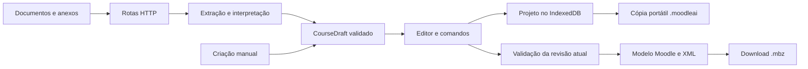

# Organização atual do Moodle-AI

Atualizado em 12/10/2026 para UX02, a partir da base `9c2167d`. Este mapa descreve os módulos implementados nesta entrega. O resultado da implementação anterior está registrado em `docs/tasks/FULL-01.json`; visual, refatoração frontend e conexão por URL estão em `docs/tasks/UX02.json`.

## Onde está cada responsabilidade

```text
Moodle-AI/
├─ app/
│  ├─ page.tsx                  monta CourseBuilder
│  ├─ globals.css               tokens, layout e controles compartilhados
│  ├─ cadastro-lote/page.tsx    monta StudentsWorkspace
│  ├─ datas/page.tsx            monta DatesWorkspace
│  └─ api/                     limites HTTP e composição dos serviços
├─ src/
│  ├─ domain/
│  │  ├─ course/               CourseDraft, schema e validação
│  │  ├─ dates/                regras e planos de datas
│  │  └─ students/             validação/mapeamento de alunos
│  ├─ client/
│  │  ├─ features/
│  │  │  ├─ course/            entrada, editor e diálogos do curso
│  │  │  ├─ students/          importação, mapeamento, revisão e cadastro
│  │  │  ├─ dates/             planejamento, prévia e resultado de datas
│  │  │  └─ moodle/            conexão, status e transporte do cliente
│  │  ├─ components/           conteúdo, modais, paginação e shell
│  │  │  └─ activity-editors/  formulários por tipo de atividade/questão
│  │  ├─ commands.ts           alterações validadas com revisão esperada
│  │  ├─ project.ts            projeto e criação de entidades
│  │  ├─ project-store.ts      persistência IndexedDB e migração
│  │  ├─ portable.ts           cópia .moodleai com arquivos e integridade
│  │  ├─ provenance.ts         origem dos campos/documentos
│  │  └─ webmcp.ts             leitura e propostas de agentes no navegador
│  ├─ server/
│  │  ├─ import/               DOCX/PDF/TXT, interpretação local e providers
│  │  ├─ export/               modelo Moodle, XML e arquivo MBZ
│  │  ├─ students/             leitura de CSV/XLS/XLSX
│  │  └─ moodle/               política de URL, sessão, HTTP, formulários e operações
│  ├─ visual/
│  │  ├─ owl/                  modelo, animação e lifecycle da coruja
│  │  └─ background/           cena, composição e lifecycle do fundo
│  ├─ shared/                  transporte HTTP, origem e utilitários de arquivo
│  └─ cli/                     validação de draft por terminal
├─ public/                     fontes, ícones e Three.js local/licenciado
├─ tests/                      testes por domínio + fixtures fictícias
├─ scripts/                    comandos de teste e apoio
└─ docs/
   ├─ specs/ e tickets/        requisitos e fatias de entrega
   ├─ tasks/                  revisões, evidências e integração por tarefa
   └─ design-proposals/        protótipos e histórico visual
```

## Como os dados passam pela aplicação



O `CourseDraft` é o contrato central. IDs estáveis associam seções, atividades e anexos. A mesma validação é usada na entrada, no editor e na exportação. A cópia portátil inclui arquivos; o IndexedDB guarda o projeto no navegador. A coruja e o fundo são efeitos de apresentação e não participam do estado do curso.

As rotas em `app/api` validam o transporte e chamam `src/server`. O domínio não importa servidor, React ou APIs Node. A inspeção de imports não encontrou importação direta de `src/server` no cliente. Isso estabelece a separação de responsabilidades; não é, sozinho, uma auditoria completa de segurança.

## Componentes, hooks e helpers

As páginas apenas escolhem o workspace. Componentes montam os painéis e recebem os dados/ações necessários. Hooks coordenam estado, solicitações e invalidação de prévias. Helpers concentram transformações sem UI; tipos e schemas explicitam os contratos. Domínio, providers de IA, exportação e operações Moodle continuam em suas camadas próprias.

| Área | Organização |
| --- | --- |
| Curso | `entry/`, `editor/`, `dialogs/`; hooks de projeto/persistência, navegação, importação, transferência e diálogos; `helpers.ts`, `types.ts`, `workspace-session.ts` |
| Atividades | Despachante comum `activity-editor.tsx`, formulários em `activity-editors/`; questões e respostas em componentes próprios |
| Alunos | Componentes de importação, mapeamento, tabela, revisão e confirmação; hooks de fonte, CSV, Moodle e coordenação; helpers, schemas e tipos |
| Datas | `DatesWorkspace`, painéis de formulário/conexão/prévia/resultado; `use-date-planner.ts`, `helpers.ts` e `types.ts` |
| Conexão | Componentes de login/status, hook da sessão e helpers de transporte; compatibilidade exportada por `components/moodle-connection.tsx` |

O estado de confirmação permanece junto de suas ações assíncronas: alterar dados invalida a prévia, confirmar consome a autorização uma vez e resultado desconhecido impede repetição automática. Não foram criados hooks genéricos artificiais para esconder essas regras.

Antes, `app/page.tsx` tinha 2729 linhas, alunos 1012 e o editor de atividades 1204. A divisão atual permite alterar um painel ou fluxo sem percorrer toda a página. O orquestrador do curso ainda conecta várias ações porque coordena o workspace; os filhos recebem contratos menores.

`app/globals.css` ainda concentra os tokens e estilos compartilhados, e `src/server/export/builders.ts` mantém os builders XML. Não houve divisão desses builders nesta entrega. A separação evita misturar a refatoração frontend com alterações no formato de backup já validado.

## Conexão Moodle por URL

Em Alunos ou Datas, a pessoa informa a URL base, usuário e senha. O servidor autentica pelos formulários web do Moodle e mantém cookies em uma sessão vinculada àquela instalação. A UI recebe apenas o cookie opaco da aplicação. Não é uma conexão por token REST.

São aceitas URLs públicas HTTP/HTTPS, inclusive subdiretórios. A política de URL verifica host e DNS e o transporte nativo fixa o IP validado no socket, mantendo a identidade TLS. Redirecionamentos ficam na mesma instalação. IPs internos/reservados são bloqueados; a única exceção local é `http://localhost:3211/`. SSO e formulários diferentes podem exigir outro adaptador; uma URL válida não comprova compatibilidade.

## Por que a interface divergiu do design system

O catálogo e a aplicação são implementações distintas. Os tokens de verde, Nunito e vidro foram transferidos, mas alguns comportamentos do protótipo não foram: Tarefas/Quizzes foram recolhidos em “documentos complementares”, e parte dos controles permaneceu com acabamento nativo diferente. A transparência do painel também foi aplicada a áreas de texto que precisavam de uma superfície de leitura mais estável.

UX02 corrige a visibilidade dos grupos, a hierarquia, o contraste e o acabamento compartilhado. O catálogo histórico continua útil como referência; a aplicação e sua folha de estilo são o código executado. Manter dois sistemas independentes sem um catálogo alimentado pelos componentes reais pode gerar novas divergências.

## Como acompanhar

- Iniciar: `npm run dev` (Node 24), endereço `http://127.0.0.1:3210/`.
- Verificação: `npm run check` executa TypeScript, ESLint, testes, build Next e CLI.
- Requisitos: `docs/PRD.md`, `docs/ARCHITECTURE.md`, `docs/DESIGN_BRIEF.md`.
- Entrega anterior: `docs/tasks/FULL-01.json` e evidências na pasta de mesmo nome.
- Correção atual: `docs/specs/UX02-visual-refinement.md` e `docs/tasks/UX02.json`.

O laboratório autorizado é local, em `http://localhost:3211/`, com dados fictícios. Moodle IFCE não é usado. Destinos públicos são simulados nos testes. Providers reais de IA existem, mas a validação empregou respostas simuladas, sem chamadas pagas. CodeGraph está instalado, porém sem índice disponível nesta execução; o mapa foi construído por inspeção dos arquivos e imports.
