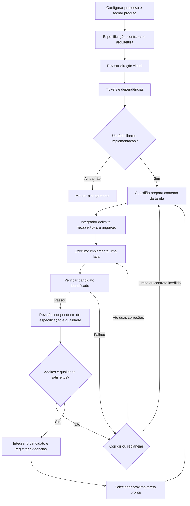

# Pipeline de desenvolvimento do Moodle AI

**Estado atual: execução inicial liberada em 12/10/2026.** O usuário pediu para iniciar execução/criação e confirmou o Moodle-AI nesta conversa. Essa instrução substitui o bloqueio anterior. [V01](specs/V01-course-to-mbz.md) fixa a primeira spec; [tickets locais](tickets/README.md) e [registro V01-01](tasks/V01-01.json) acompanham a execução. O HTML de planejamento continua referência visual, distinto do futuro editor.

Este documento é a visão de entrada do processo. [AGENT_WORKFLOW.md](AGENT_WORKFLOW.md) define responsabilidades e verificações; [AGENT_LOOP.md](AGENT_LOOP.md) descreve o registro de tarefas e suas transições. A [skill local project-loop](../.agents/skills/project-loop/SKILL.md) orienta a coordenação pelo host, sem executar agentes automaticamente.

## Preparação antes de desenvolver

| Etapa | Trabalho e skills | Artefato para revisar | Condição para avançar |
| --- | --- | --- | --- |
| 1. Configurar o processo | `project-loop` local: acompanhamento em Markdown e task JSON; domínio único com glossário e arquitetura existentes. | `docs/agents/issue-tracker.md` e `docs/agents/domain.md`. | Configuração local reversível conforme o início autorizado. Nenhum tracker externo é criado por inferência; workflows upstream só quando invocados. |
| 2. Fechar produto | `grill-with-docs` e `domain-modeling`: resolver decisões que mudam escopo, linguagem e comportamento. | PRD revisado, glossário e decisões registradas. | Público, duas estruturas DOCX, compatibilidade Moodle e limites do MVP definidos. |
| 3. Especificar a primeira entrega | Integrador detalha V01 no `project-loop`, usando comportamento/contrato do planejamento. | `docs/specs/V01-course-to-mbz.md`. | Interface pública e aceites fixados antes de execução; decisões de rotina seguem o início autorizado. |
| 4. Aprovar a direção visual | `frontend-design`: avaliar o catálogo e a jornada de edição. | `design-system.html` e `DESIGN_BRIEF.md`. | Decisões de design registradas; notas no HTML são locais, sem envio automático ao chat. |
| 5. Dividir o trabalho | Integrador deriva entregas locais no `project-loop`; não afirma execução de `to-tickets` upstream. | Um Markdown por ticket e contratos de tarefa. | Aceites, dependências, verificações e responsável por cada caminho definidos. |
| 6. Iniciar execução | Implementar a tarefa pronta, sem checks fictícios. | Contrato V01-01. | Liberação já recebida; nova confirmação não é necessária para implementação local. |

As skills já estão instaladas. Esta execução usa o loop local; não afirma execução integral do setup/entrevista/publicação upstream. A spec V01 delimita decisões do bootstrap; decisões do restante do produto continuam identificadas como propostas.

## Contrato de cada tarefa

Antes de delegar, o integrador registra:

- Objetivo demonstrável, requisitos de origem e exclusões.
- Contexto com arquivos, decisões, dúvidas e estado do CodeGraph.
- Entradas, saídas, invariantes e erros da interface compartilhada.
- Dependências satisfeitas e um responsável de escrita por caminho.
- Aceites observáveis e verificações adequadas à mudança.
- Revisão do candidato: commit quando disponível ou digest de um snapshot dos arquivos.
- Dois relatórios separados, de especificação e qualidade, ligados ao mesmo candidato.
- Até duas correções por tarefa; diagnóstico e replanejamento quando o limite é atingido.

O registro segue [o template local](../.agents/skills/project-loop/assets/task.json). O helper valida campos e transições; o integrador confere as evidências reais. Ele não comprova que um comando passou, que dependências foram satisfeitas ou que os arquivos de fato respeitaram a propriedade registrada.

## Papéis e capacidade

O agente principal integra. O guardião reúne contexto; executores entregam tarefas prontas; revisores avaliam sem alterar o candidato. Há até três subagentes simultâneos nesta sessão. Papéis são atribuídos conforme a tarefa, sem manter cinco agentes permanentes.

Revisão de especificação verifica cada aceite. Revisão de qualidade verifica contratos, erros, limites entre módulos e testes. O executor não aprova sua própria entrega. Os dois relatórios precisam de contextos separados; podem ocorrer em sequência para respeitar a capacidade disponível.

Mudar o candidato invalida checks e aprovações ligados ao conteúdo anterior. Integrar não significa publicar, fazer deploy ou operar Moodle real.

## Verificações por entrega

| Entrega | Evidência necessária |
| --- | --- |
| Planejamento e documentação | Coerência de requisitos, links, diagramas, decisões e limites. Não criar testes artificiais para texto. |
| Domínio e exportação | TDD nas interfaces públicas acordadas; casos independentes da implementação e referências XML válidas. |
| API, IA e anexos | Contratos com serviço simulado, entradas inválidas, limites, timeout e limpeza em falha parcial. |
| Interface | Navegador: edição, erros, teclado e tela estreita; checks de código aplicáveis à fatia. |
| Integração da aplicação | Typecheck, lint, testes relevantes e build, depois de definidos na inicialização do app. |
| Liberação pública | Gates S01–S04 do backlog e restauração dos dois exemplos no Moodle de teste registrado. |

A futura automação de CI repetirá os checks definidos para a aplicação. Ainda não há pipeline de CI nem scripts de build/typecheck/lint do app. A aprovação do plano vem antes de criar essa implementação.

## CodeGraph e fontes de contexto

CodeGraph MCP 1.6.2 foi instalado e seu servidor foi testado diretamente. O Codex desta sessão ainda não expõe a ferramenta; a configuração local precisa ser carregada num projeto confiável. A CLI local atende consultas quando houver código indexado. Detalhes e evidências estão em [SKILLS_AND_MCP.md](SKILLS_AND_MCP.md).

O índice inicial não possui símbolos da aplicação. O guardião lê o PRD e os ADRs para intenção do produto e usa o grafo para estrutura do código existente. Resultados vazios ou desatualizados pedem inspeção local e registro da limitação. Compatibilidade Moodle depende de restauração testada.

## Próxima decisão

A proposta é acompanhar este início com arquivos Markdown locais e um único glossário de domínio. Essa escolha ainda precisa ser confirmada no fluxo de `setup-matt-pocock-skills`. Em seguida, revisar as dúvidas do PRD e selecionar o comportamento mínimo da primeira fatia. Até a liberação explícita do usuário, agentes trabalham somente no planejamento e na revisão dos artefatos existentes.
