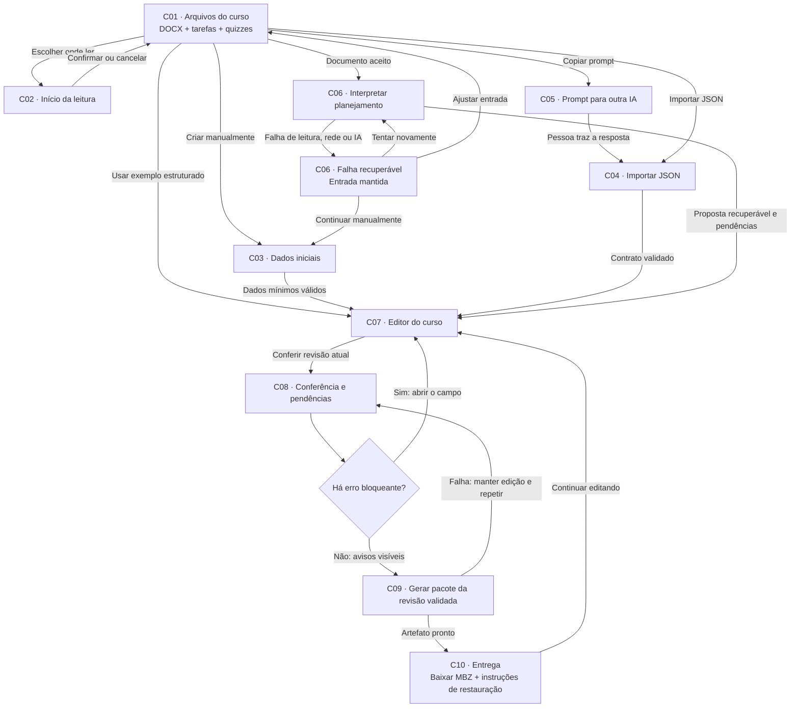
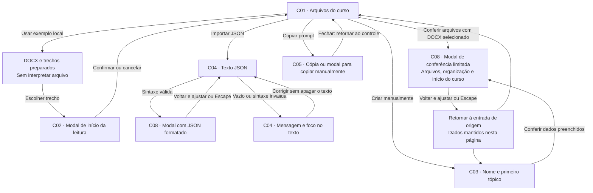
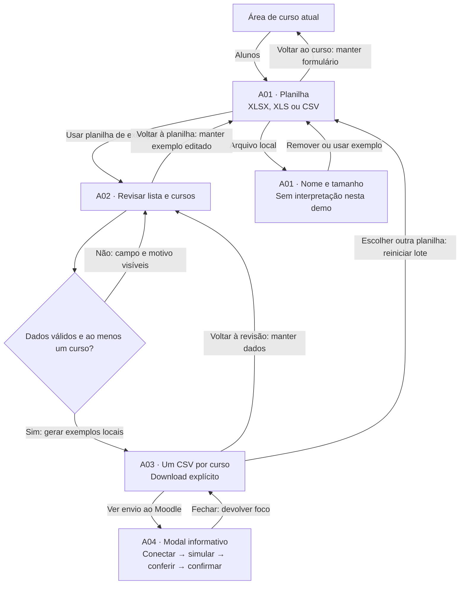
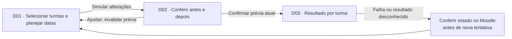

# Fluxograma de telas do Moodle AI

**Revisão: 12/10/2026. Estado: planejamento e protótipo local; aplicação ainda não iniciada.**

O mapa organiza os caminhos que a pessoa percorre, as decisões necessárias para avançar e os retornos que preservam seu trabalho. O [quadro visual de telas](screen-flow.html) usa os mesmos IDs. O comportamento existente pode ser experimentado na [prévia navegável](design-proposals/glass-owl-v4/index.html); o [catálogo de design](../design-system.html) apresenta componentes e um estudo visual do editor.

**Legenda:** “Demo” significa comportamento local existente; “Planejado” significa requisito do MVP sem implementação; “Futuro” significa entrega fora do MVP. Estados de falha pertencem à tela em que ocorreram, sem criar uma rota distinta para cada mensagem. Os IDs C, A e D identificam telas ou modais e permanecem estáveis quando o texto da interface mudar.

## 1. Jornada de criação do curso planejada

Documento de planejamento, tarefas e quizzes ficam visíveis juntos em C01. O DOCX de planejamento é obrigatório nessa entrada; tarefas e quizzes são complementos opcionais. A pessoa também pode criar manualmente ou começar por um exemplo. Todas as entradas deverão convergir para o mesmo `CourseDraft` validado, conforme o [PRD](PRD.md) e a [arquitetura](ARCHITECTURE.md).

A organização por tópicos ou semanas, o início do curso e os prazos das atividades pertencem ao editor C07. C08 resume esse cronograma e leva ao campo que precisa de correção. Isso é diferente de alterar datas de uma turma já publicada, que pertence ao fluxo futuro D01–D03.

Voltar ao editor preserva curso, anexos, ordem e vínculos. Toda edição posterior invalida a validação anterior; a exportação corresponde a uma revisão identificada. Uma falha de geração não apaga o rascunho nem seus anexos. Retornar à entrada permite ajustar a origem; substituir um curso já editado deve ser uma decisão explícita, com oportunidade de salvar uma cópia. Essas são regras propostas, não capacidades comprovadas pelo protótipo atual.

## 2. O que o protótipo de curso permite hoje

A conferência atual é um modal de arquivos, dados iniciais ou JSON. O estudo de editor do catálogo é uma composição visual separada. A barra “Documentos → Revisão → Baixar curso” expressa a intenção do produto; ela não comprova uma jornada de exportação funcionando.

Arquivos locais são identificados por nome e tamanho. O exemplo inclui um DOCX empacotado e trechos previamente preparados; não há parser genérico nem leitura com IA. Escolher onde ler funciona sobre esses trechos. JSON passa apenas por `JSON.parse`; qualquer valor JSON sintaticamente válido pode abrir a conferência, sem comprovar o contrato de curso. O prompt também é ilustrativo, ainda sem o schema versionado planejado.

## 3. Cadastro em lote de alunos

Alunos tem acesso próprio no cabeçalho e não substitui a jornada do curso. A demo usa uma lista fictícia editável, com pendência inicial para ser corrigida. Uma planilha real selecionada mostra apenas metadados; o caminho de revisão é ativado por “Usar planilha de exemplo”. Cada CSV de demonstração contém todos os alunos em um dos cursos escolhidos, sem distribuição automática entre cursos. A [revisão desse fluxo](STUDENTS_DESIGN_REVIEW.md) registra a comparação com a referência.

F01, F02 e F03 do [backlog](BACKLOG.md) continuam futuras: interpretar planilhas reais, cadastrar pessoas e aplicar mudanças no Moodle exigem contratos, configuração, validação e laboratório próprios. A04 não se autentica, não simula uma operação no servidor e não envia cadastro. No fluxo real futuro, alterar dados ou opções deverá invalidar a prévia anterior; uma falha de envio com resultado desconhecido exigirá conferir o estado antes de repetir.

## 4. Datas em turmas publicadas — futuro

Nenhuma tela D está implementada na nova demo. Não confundir o calendário de início do curso, que existe em C08, com edição de turmas publicadas. Esse fluxo tem resultado parcial e preservação das demais configurações como requisitos futuros.

## Inventário estável de telas e estados

Todas as telas de demo abaixo vivem na mesma [URL da prévia](design-proposals/glass-owl-v4/index.html). Os seletores localizam o elemento para QA; fragmentos não abrem automaticamente painéis ocultos e não são rotas da aplicação.

| ID | Tela ou superfície | Estado existente / status | Próxima ação e retorno | Localização atual |
| --- | --- | --- | --- | --- |
| C01 | Arquivos do curso | **Demo:** vazio, arquivos selecionados, formato inválido, exemplo carregando ou indisponível. | Selecionar DOCX, complementos ou exemplo; conferir arquivos. Remover e trocar preserva os outros grupos. | `#panel-files` |
| C02 | Início da leitura | **Demo:** modal disponível para o exemplo; trecho escolhido ou documento inteiro. Arquivo local não tem trechos extraídos. | Confirmar seleção ou cancelar; retorna a C01. | `#reading-dialog` |
| C03 | Criar manualmente | **Demo:** nome e primeiro tópico, com validação obrigatória. **Planejado:** criação de todas as aulas e atividades via C07. | Conferir início do curso; fechar conferência mantém campos. | `#panel-manual` |
| C04 | Importar JSON | **Demo:** vazio, texto inválido ou sintaxe válida. **Planejado:** validar versão e contrato antes de aceitar um rascunho. | Corrigir texto, usar exemplo ou conferir; voltar a C01. | `#panel-json` |
| C05 | Copiar prompt | **Demo:** status de cópia ou modal de cópia manual. **Planejado:** prompt derivado do contrato e perfis reais. | Usar em outra IA e trazer resposta a C04; fechar devolve foco. | `[data-copy-prompt]`, `#prompt-dialog` |
| C06 | Interpretar planejamento | **Planejado:** leitura, interpretação, validação, cancelamento e falha recuperável. | Abrir C07; repetir com mesma entrada, ajustar C01 ou seguir por C03. | Sem rota ou tela funcional. |
| C07 | Editor do curso | **Planejado:** curso, aulas, atividades, questões, anexos, notas e datas; persistência e origem. | Corrigir pendências e conferir em C08. | Estudo visual isolado no catálogo; sem editor completo. |
| C08 | Conferência e pendências | **Demo limitada:** modal de arquivos/dados/JSON e opções de organização/data. **Planejado:** resumo do curso e erros localizados com bloqueio de exportação. | Hoje retorna à entrada. No MVP, abre campo em C07 ou libera C09. | `#preview-dialog` |
| C09 | Geração do pacote | **Planejado:** revisão validada, job em execução, falha e artefato pronto. | Repetir sem apagar curso ou ir a C10. | Sem rota ou tela funcional. |
| C10 | Entrega do curso | **Planejado:** resumo, MBZ, compatibilidade testada e instruções de restauração. | Baixar explicitamente ou continuar em C07. | Sem rota ou tela funcional; nenhum MBZ é gerado pela demo. |
| A01 | Planilha de alunos | **Demo:** vazio, metadados, formato inválido e exemplo editado disponível. | Abrir exemplo em A02; voltar ao curso recupera o modo anterior. | `#student-upload-stage` |
| A02 | Revisão de alunos e cursos | **Demo:** lista fictícia, campos editáveis, erros e cursos de destino. | Corrigir e gerar CSVs em A03; voltar a A01 preserva exemplo. | `#student-review-stage` |
| A03 | CSVs por curso | **Demo:** arquivos locais derivados da lista fictícia editada. | Download, editar lote, reiniciar ou ver A04. | `#student-done-stage` |
| A04 | Envio ao Moodle | **Demo:** modal explicativo. **Futuro:** conexão, prévia, confirmação e resultado por aluno. | Fechar modal e voltar ao controle acionador. | `#student-moodle-dialog` |
| D01 | Planejar datas de turmas | **Futuro:** seleção de turmas e mudanças propostas. | Simular D02; manter formulário em erro. | Não existe na demo. |
| D02 | Conferir datas | **Futuro:** antes/depois vinculado à revisão do plano. | Ajustar D01 ou confirmar D03. | Não existe na demo. |
| D03 | Resultado por turma | **Futuro:** aplicado, falhou ou resultado desconhecido por turma. | Conferir estado antes de repetir. | Não existe na demo. |

## Pontos de aceite para a navegação

- Alguém encontra documento, tarefas, quizzes, criação manual, JSON e prompt sem depender de instrução oral.
- Uma pendência leva ao campo correto e informa o motivo do bloqueio; corrigir revalida o estado atual.
- Voltar e fechar modal preserva os dados pertinentes; reiniciar e substituir têm efeitos explícitos.
- Falha de interpretação ou exportação oferece recuperação sem apagar entrada ou edição.
- Teclado e tela estreita permitem completar os caminhos existentes. O teste do protótipo não comprova a usabilidade das telas planejadas.

As lacunas para iniciar a implementação e os gates de demonstração estão em [PLANNING_READINESS.md](PLANNING_READINESS.md). A revisão de navegação deverá registrar tarefas executadas e limitações, sem apresentar inspeção automatizada como pesquisa com pessoas.
