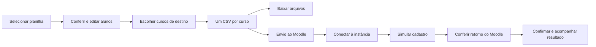

# Revisão do cadastro em lote — 12/10/2026

O usuário pediu que o design preserve o fluxo da aplicação de referência. A ficha individual de nome e e-mail não representa o trabalho original: receber uma planilha, conferir uma lista e preparar arquivos por curso.

## Fluxo de referência

Todos os alunos da lista entram em cada curso escolhido. Vários destinos significam vários arquivos com o mesmo lote, com o destino correspondente em cada CSV; não significam repartir a lista automaticamente. Baixar um arquivo e cadastrar pessoas no Moodle são ações separadas.

Fontes locais, somente lidas: [jornada](../../CourseGen-AI/ui/app/cadastro-lote/page.tsx), [entrada](../../CourseGen-AI/ui/app/cadastro-lote/components/PlanilhaUpload.tsx), [revisão e cursos](../../CourseGen-AI/ui/app/cadastro-lote/components/AlunosReview.tsx), [arquivos](../../CourseGen-AI/ui/app/cadastro-lote/components/CsvDownload.tsx), [envio](../../CourseGen-AI/ui/app/cadastro-lote/components/EnvioMoodle.tsx) e [normalização](../../CourseGen-AI/ui/server/alunos.js). A tela pública de entrada também foi inspecionada; a revisão não executou extração por IA nem cadastro real.

## Adaptação genérica

- Usar “Usuário”, “Nome”, “Sobrenome”, “E-mail”, “Cidade” e “Papel” na revisão. A identificação por CPF pertence a um perfil, não a todos os lotes.
- Manter o curso como destino do lote e usar o nome breve do curso no Moodle.
- Não copiar senha fixa, cidade padrão ou endereço de uma instância. Política de contas, identificação e papéis exigem escolhas explícitas na futura integração.
- Mostrar pendências por campo e por linha. Preencher qualquer texto não comprova que um e-mail ou identificador ficou válido.
- Mostrar todos os alunos e a quantidade de arquivos antes do download; downloads são explícitos e individuais.

## Limite do protótipo

A proposta visual acompanha Planilha → Revisão → Download. O exemplo fictício demonstra edição, pendências e vários cursos. Arquivos locais exibem apenas nome e tamanho; não recebem uma lista fictícia apresentada como extração real. Os CSVs de demonstração são arquivos locais de exemplo, sem senha padrão nem comprovação de compatibilidade de importação.

“Ver envio ao Moodle” explica conexão, simulação e confirmação, sem autenticar ou enviar registros. A função futura F01 continua fora do MVP de preparação de cursos, conforme o [PRD](PRD.md). Esta revisão de design não inicia sua implementação.

## Identidade e interação

A marca do cabeçalho usa uma coruja vetorial compacta com M geométrico na barriga; o favicon usa a versão sem letra. A mascote 3D conserva o tamanho e o M oficial já aprovados. Os controles Alunos, Fundo e Tema usam cápsulas e seleção suave, sem barra interna.

Após quatro segundos de ponteiro parado, até seis vagalumes no desktop ou três na composição compacta se aproximam. Ao retomar o movimento, acompanham brevemente e retornam às laterais. O efeito fica atrás do vidro e respeita fundo oculto, aba oculta e movimento reduzido.
